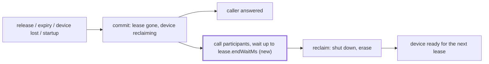
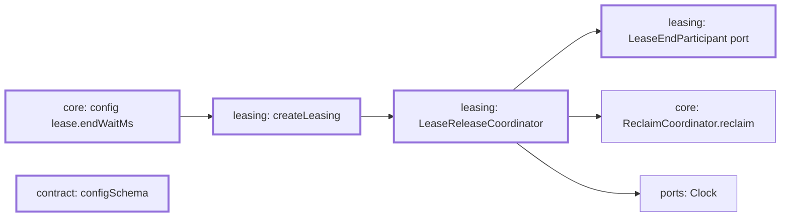

# Leasing calls lease-end participants before it reclaims a device

Part of #466.

## Scope

After this PR, an optional module can hand leasing a lease-end participant. For every simlock lease that ends, leasing calls each participant after the end is committed and before the device's reclaim starts. It waits until they finish or `lease.endWaitMs` passes (default 10 minutes), then reclaims. Graceful daemon stop and `simlock nuke` cut the wait short. Nothing registers a participant yet: the agent-device host does in T6. So with the daemon as shipped, nothing a user sees changes, apart from the new config key.

## In short

Today a release commits (lease gone, device `reclaiming`), answers the caller, and starts the wipe straight away. After this PR, leasing first calls the registered participants and waits for them, still in the background. The caller is answered as fast as today.

A **lease-end participant** is code an optional module gives leasing because it must act on a device after its simlock lease ends and before the device is wiped. Example: T6's agent-device host ends the agent-device session on that device, letting a running command finish first.



If this goes wrong, a released device stays `reclaiming` for up to 10 minutes for no reason, or the wipe starts while a participant still works on the device.

## Technical spec

### Modules touched



- `src/leasing/lease-ports.ts` declares the port. The core imports nothing from it, and leasing imports no participant.
  ```ts
  export interface EndedLease {
    readonly leaseId: string;
    readonly ownerId: string;
    readonly deviceId: string; // simlock's device id, as on lease.released
    readonly platform: Platform; // the device's spec.platform
    readonly reason: "explicit" | "killed" | "expired" | "device-lost";
  }
  export interface LeaseEndParticipant {
    leaseEnded(ended: EndedLease, signal: AbortSignal): Promise<void>;
  }
  ```
  `reason` is the reason the lease ended with, the one `lease.released` or `lease.expired` carries.
- `src/leasing/index.ts` exports both types.
- `src/leasing/create-leasing.ts`: `LeasingOptions` gains `leaseEndParticipants?: readonly LeaseEndParticipant[]` (default none). It passes them, `options.clock` and `config.lease.endWaitMs` to the coordinator.
- `src/leasing/lease-release-coordinator.ts` does the calls:
  - **When.** After the commit, and after `lease.released` or `lease.expired` is emitted. Never inside `decisions.run`: a participant may take minutes, and every other lease operation must go on meanwhile.
  - **Endings that start a background reclaim** (`#release` with `"background"`: `release`, `releaseAll`, `releaseDeviceLost`, `expire`, and `endAtStartup` with `reclaim`). `#reclaimInBackground` (:275) takes the reclaim claim first, then calls every participant at once, then starts `reclaim.reclaim` when all have settled or the ceiling passes, whichever comes first. The whole chain stays in `#backgroundReclaims`, so the claim is released only when the reclaim ends, as today.
  - **The ceiling.** One budget per ended lease, shared by all its participants, measured from the moment they are called. It never restarts. Armed with `Clock.setTimer`, cancelled when the participants settle first. When it passes, leasing aborts the signal, logs a warning with the lease id and device id, and starts the reclaim. It does not wait for the participant to return after that.
  - **A participant that rejects or throws** is logged as an error with the lease id, device id and error message. The other participants are still awaited, and the reclaim goes ahead.
  - **Endings that start no reclaim** (`endAtStartup` with `wait` and with `missing`, and `endForAbsentDevice`). The participants are called the same way, with a signal that aborts at the ceiling. Nothing waits for them. A rejection is logged.
  - **Maintenance (`simlock nuke`).** `beginMaintenance` aborts every signal handed out, so each background reclaim stops waiting and starts at once; then it waits for them as today. While maintenance is active, every participant call gets an already aborted signal, so `releaseAllDuringMaintenance` reclaims at once.
  - **Graceful stop.** `Leasing.settle()` aborts every signal handed out before it waits for the background reclaims. Every ending after that, in this process, passes an already aborted signal.
  - **`Leasing.dispose()`** also cancels every ceiling timer still armed.
  - **No participant.** The reclaim starts exactly as today: no timer, no extra step before `reclaim.reclaim`.
  - A release that commits nothing (unknown lease, or an expiry whose deadline moved) calls no participant.
- `src/leasing/testing.ts`: `TestEngineOptions` gains `leaseEndParticipants`, passed to `createLeasing`.
- `src/core/config.ts`: `Config.lease.endWaitMs`, default `600_000` (the same as `exec.timeoutMs`), validated as a positive number.
- `src/contract/schemas.ts`: `configSchema.lease` gains `endWaitMs: z.number()`.
- Every test `Config` literal gains `lease.endWaitMs` (about 19 test files; mechanical).

### Contract and event changes

- `configSchema` (the `config.get` output) gains `lease.endWaitMs`: protocol +1 at merge. Rerun the tests of every surface that publishes `config.get`.
- No event changes. `lease.released` and `lease.expired` still fire when the end is committed. No new event.

### Other code on the same state

The state: an ended lease's device in `reclaiming`, its reclaim claim, the background reclaim set, the maintenance depth, and the new ceiling timers.

- `StartupConverger#recoverInterruptedReclaims` (`src/core/startup-converger.ts:55`) skips claimed devices (`:86`). The claim is taken before the wait, so a device whose participants are still running is never recovered in-process. Startup endings with `reclaim` run in `leasing.reconcile`, before `core.converge`, so they hold the claim first. The waiting release wins.
- A daemon that dies mid-wait leaves the device `reclaiming` with no claim. The next start's interrupted-reclaim recovery (`ReclaimCoordinator.recoverInterrupted`, `src/core/reclaim-coordinator.ts:134`) wipes it and calls no participant, as today. The participants' own restart handles their side.
- `isStalledTransition` (`src/core/doctor.ts:939-946`) excludes claimed devices, so a long wait is never a stall.
- The warm pool (`src/core/warm-pool/policy.ts:135-144`) counts a `reclaiming` device's running slot and treats a claimed device as not idle. It does so for the whole wait, as it does for a wipe today.
- The reclaim stage told to a queued waiter (`src/leasing/lease-acquisition-coordinator.ts:1074-1086`) comes from the driver's reclaim estimate and does not include the wait. Unchanged: a waiter may wait longer than told.
- `NukeService#runNuke` (`src/core/nuke-service.ts:72-78`) waits for background reclaims in `beginMaintenance`. With the cut-short, it no longer waits for a participant. Nuke wins.
- `DaemonServer#stop` (`src/daemon/server.ts:600-618`) runs `stopAuxiliary`, then `settle` (`src/daemon/main.ts:445`, which calls `leasing.settle()`), then `dispose`. The cut-short in `settle` makes stop wait only for the wipes. Stop wins.
- `PhysicalDeviceWatcher` (`src/leasing/physical-device-watcher.ts`) ends a lease through `endForAbsentDevice` (no wait). It acts on a `reclaiming` device only when a killed daemon left it so (`recordInterrupted`), never on one this process is waiting on. `reclaimReturned` ends no lease and calls no participant.
- `LeaseHealthMonitor` (`releaseDeviceLost`) and `LeaseExpiryScheduler` (`expire`) end leases through the paths above and wait like any release.
- A gateway runs no leasing (`startGatewayDaemon`), so this changes nothing there.

### Rules in play

- `architecture.md`: no workflow step in an event handler, which is why this is a port; every wait has a bound that does not reset; every exit leaves the claim released and the timer cancelled; dependencies point from the optional module to leasing, and leasing behaves the same with no participant.
- `events.md`: no event changes, and `lease.released` stays post-commit.
- `testing.md`: each "does not wait" test must fail when the code waits, and each "waits" test must fail when it does not.

### Tests

Seam: `createTestEngine` (`src/leasing/testing.ts`) with a test participant in `leaseEndParticipants`, `FakeClock` and `FakeDriver`; model `src/leasing/create-leasing.test.ts`. Config lines in `src/core/config.test.ts`.

- a release answers its caller while the participant has not returned, and the participant gets the lease id, owner, simlock device id, platform and reason `explicit`
- the participant is called after `lease.released` is emitted, while the device is `reclaiming` and has no lease
- the driver's reclaim does not start until the participant returns; when it returns, the reclaim runs and the device becomes `ready`
- while the participant has not returned, a request for the same spec is not granted that device, and it is granted it after the reclaim
- the device is claimed (`claimReader.isClaimed`) from before the participant is called until the reclaim ends
- while the participant has not returned, a renew of another lease and a grant of another device both complete
- a participant that never returns: 1 ms before `lease.endWaitMs` the reclaim has not started; at `lease.endWaitMs` its signal is aborted, a warning naming the lease and device is logged, and the reclaim starts
- two participants are both called before either returns; the reclaim waits for the slower one; one ceiling, counted from the call, covers both and is not reset when the first returns
- a participant that rejects, and one that throws, are each logged with the lease id; the other participant is still awaited; the device becomes `ready`
- every ending that starts a reclaim calls the participant before the reclaim, with its reason: `release` (`explicit`, `killed`), `releaseAll` (one call per lease), expiry (`expired`), the health monitor's device-lost release (`device-lost`), and a startup ending with `reclaim` (`expired`, `device-lost`)
- a startup ending with `wait` calls the participant with its reason, starts no reclaim, and leaves the device `reclaiming` with its deferred wipe recorded, as today
- a startup ending with `missing` calls the participant and marks the device missing in the same write as today, without waiting for it
- a physical device that goes absent (through `PhysicalDeviceWatcher`) calls the participant with `device-lost`, and the device becomes `absent` without waiting for it
- a call nothing waits for, still running at the ceiling, has its signal aborted then; one that rejects is logged
- a release of an unknown lease, and an expiry whose deadline was moved by a renew, call no participant
- `nuke` while a participant has not returned aborts its signal, starts the reclaim at once, and completes without the clock advancing
- `nuke` with leased devices calls each participant with an already aborted signal, and completes without the clock advancing
- after `nuke` ends, a release waits for its participant again
- `settle()` while a participant has not returned aborts its signal and returns once the reclaim settles, without the clock advancing
- a release after `settle()` began calls the participant with an already aborted signal and reclaims at once
- a participant that returns before the ceiling leaves no ceiling timer armed (`pendingTimerCount` back to what it was before the release)
- `dispose()` with a participant still running leaves no ceiling timer armed
- with no participant, the reclaim starts as today and no timer is armed between the release and the reclaim; the existing tests at `create-leasing.test.ts:260` and in "createLeasing startup reclaim backgrounding (#43)" (`:1586`) pass unchanged
- a daemon stopped while a participant has not returned: the next start's interrupted-reclaim recovery wipes the device and calls no participant registered in the new engine
- a release with a participant emits the same events in the same order as one without (`lease.released`, then `device.reclaimed`)
- `lease.endWaitMs` defaults to 600000, accepts a positive number, refuses 0, a negative number and a string with a message naming the key, and a loaded config parsed through `configSchema` keeps it

## Done when

- The tests above pass.
- Removing the wait before `reclaim.reclaim` makes "the driver's reclaim does not start until the participant returns" fail.
- Removing the cut-short from `beginMaintenance` makes the first `nuke` test fail.
- With no participant, `src/leasing/create-leasing.test.ts` and `src/leasing/lease-release-coordinator.test.ts` pass with no edits other than the new config key and the coordinator's new options.

## Out of scope

- Registering a participant, and the agent-device host: T6.
- Showing the wait in `status` or the console: the device stays `reclaiming`, and no new state is added.
- Adding the wait to the reclaim estimate a queued waiter is told.

## Depends on

## Approval

- [ ] Approved for delivery

*Written by an agent.*
