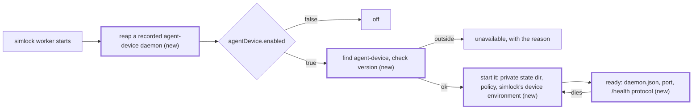
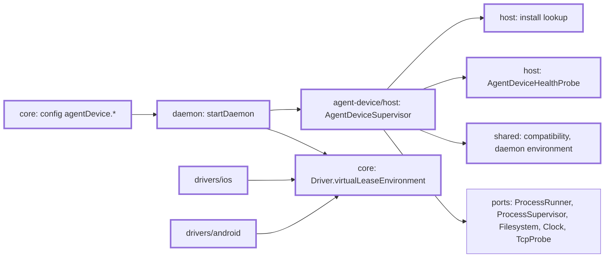
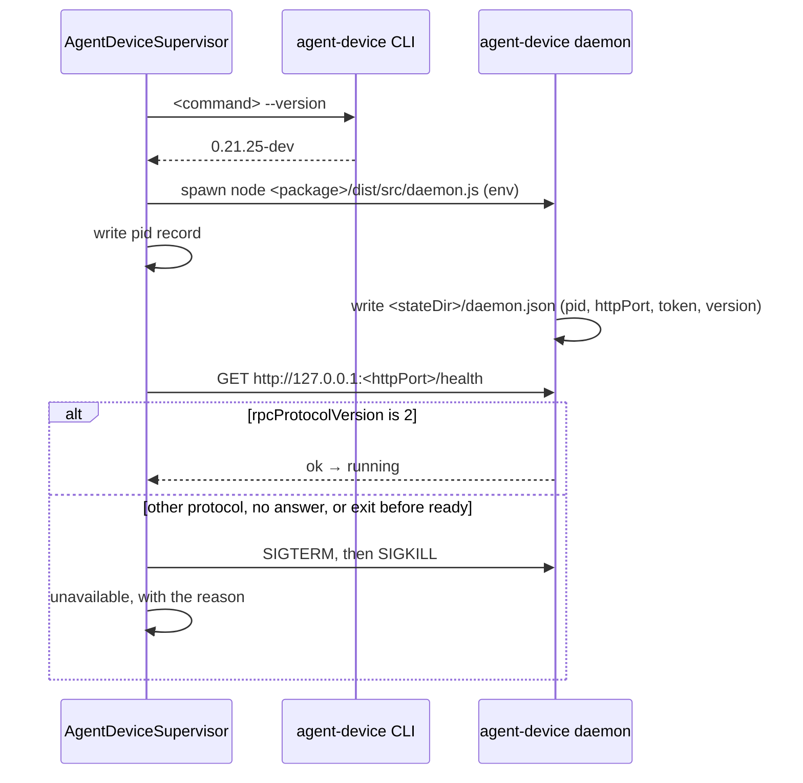

# simlock runs the agent-device daemon

Part of #466.

## Scope

After this PR, an operator who sets `agentDevice.enabled: true` gets one agent-device daemon on the worker, started and watched by simlock. It sees simlock's devices and no others, refuses `boot` and `shutdown`, keeps its files in a private directory under `SIMLOCK_HOME`, and is restarted when it dies. An agent-device that is missing, too old, or speaks another RPC protocol is not started; simlock runs on without it and says why. A daemon a killed simlock left behind is reaped at the next start. Nothing serves agent-device traffic yet (T4), and `simlock doctor` does not report it yet (T3).

## In short



New config keys:

| Key | Default | Meaning |
|---|---|---|
| `agentDevice.enabled` | `false` | Run the agent-device daemon on this worker. |
| `agentDevice.command` | `agent-device` | The agent-device executable: a name looked up on `PATH`, or a path. |

| Installed agent-device | Today | After |
|---|---|---|
| none, edge on | nothing runs | unavailable: `agent-device not found: "agent-device" is not on PATH` |
| 0.20.3 | nothing runs | unavailable: `found 0.20.3, need 0.21.25 or later` |
| 0.21.25-dev (the integration build) | nothing runs | running |
| a version that speaks RPC protocol 3 | nothing runs | unavailable: `agent-device 0.30.0 speaks RPC protocol 3, need 2` |
| any, edge off | nothing runs | nothing runs |

If this goes wrong, the agent-device daemon sees devices simlock does not own, a stray daemon survives a crash, or a broken agent-device install takes simlock down with it.

## Technical spec

### Modules touched





New module `src/agent-device/` (this task creates it; later tasks add `front/` and more of `host/`):

- `shared/compatibility.ts`: `MIN_AGENT_DEVICE_VERSION = "0.21.25"` and `AGENT_DEVICE_RPC_PROTOCOL_VERSION = 2`, and the version compare. A version is read as its first three dot-separated numbers; anything after `-` or `+` is ignored; a string without three numbers is too old. Both checks are needed: the RPC protocol tells whether simlock's pinned proxy and the CLI can talk to this daemon, and the version tells whether it carries the changes simlock needs (a caller-chosen lease id, sessions ending with their lease, and the rest), which agent-device added with no protocol bump.
- `shared/daemon-environment.ts`: the environment and the policy file below, as data.
- `host/install.ts`: finds the install. A command with a `/` is used as given; a name is looked up in each `PATH` entry in order. Its real path (`Filesystem.realpath`) is `<package>/bin/agent-device.mjs`. `<package>/package.json` must name `agent-device`. The daemon entry is `<package>/dist/src/internal/daemon.js` when it exists, else `<package>/dist/src/daemon.js`, the same order agent-device's own client uses.
- `host/health.ts`: `AgentDeviceHealthProbe { read(baseUrl: string): Promise<unknown> }`, a `GET <baseUrl>/health` bounded to 5 s. The Node adapter uses the global `fetch`. The fake is in `testing.ts`.
- `host/agent-device-supervisor.ts`: `AgentDeviceSupervisor` with `start()`, `stop()` and `availability()`:
  ```ts
  type AgentDeviceAvailability =
    | { state: "off" }
    | { state: "starting" }
    | { state: "running"; version: string; baseUrl: string; token: string; generation: number }
    | { state: "unavailable"; reason: "not-found" | "not-agent-device" | "wrong-version" | "state-dir" | "start-failed"; message: string; remedy: string };
  ```
  `baseUrl` is `http://127.0.0.1:<httpPort>`. `generation` goes up by one on every successful start, so later tasks can tell a restarted daemon. A `start-failed` is retried (below). The other reasons need the operator, so their remedy ends by saying to restart the daemon (`simlock daemon stop`, then `simlock daemon start`).
- `index.ts` exports `AgentDeviceSupervisor`, `AgentDeviceAvailability` and the Node health probe. `testing.ts` exports `FakeAgentDeviceHealth`.

What `start()` does, in order:

1. **Reap.** The pid record is `<SIMLOCK_HOME>/agent-device-daemon.json`: `{ "pid": number, "entry": string, "startedAt": number }`. If it names a live pid, the supervisor reads `ps -o args= -p <pid>`. It is this daemon when the line holds the recorded `entry` and `<stateDir>/daemon.json` is missing or names the same pid. Then SIGTERM, wait up to 10 s, check identity again, SIGKILL, wait up to 2 s (the grace times agent-device's own `daemon stop` uses), and remove the record. A dead pid, or a line that shows another command: remove the record and signal nothing. A `ps` that fails, times out or prints nothing: keep the record, signal nothing, start nothing, and report `start-failed` naming the pid. The reap runs whether or not the edge is on.
2. **Off.** With `agentDevice.enabled` false, availability is `off` and nothing else runs.
3. **Find and check.** `not-found` or `not-agent-device` from the lookup. Then `<command> --version` (10 s limit), its first line read as the version. Below `MIN_AGENT_DEVICE_VERSION`: `wrong-version`, message `found <version>, need 0.21.25 or later`. A failed or empty `--version` is `not-agent-device`.
4. **State dir.** `<SIMLOCK_HOME>/agent-device`, created with mode 0700, or set to 0700 when it exists. A symlink (`lstat`) or a non-directory there is `state-dir`; nothing is spawned.
5. **Policy file.** `<stateDir>/policy.json`, written atomically before each spawn: `{"version":1,"commands":{"deny":["boot","shutdown"]},"capabilities":{"deny":["device-shutdown"]}}`.
6. **Spawn** `<node> <entry>` with `stdio: "ignore"`. `<node>` is the simlock process's own `process.execPath`, passed in by `startDaemon`. The environment is the base environment `startDaemon` passes (`process.env`) with every `AGENT_DEVICE_*` key removed, then every driver's `virtualLeaseEnvironment()` merged, unread, then:
   - `AGENT_DEVICE_STATE_DIR` = the state dir;
   - `AGENT_DEVICE_DAEMON_SERVER_MODE` = `http`;
   - `AGENT_DEVICE_DAEMON_IDLE_TIMEOUT_MS` = `0`, so it never exits on its own after 5 idle minutes;
   - `AGENT_DEVICE_DAEMON_POLICY` = the policy file;
   - `AGENT_DEVICE_LEASE_MAX_TTL_MS` = the larger of 24 hours and twice `lease.maxTtlMs`, so an agent-device lease never hits its ceiling before its simlock lease;
   - `AGENT_DEVICE_IOS_SIMULATOR_DEVICE_SET` = the value of `SIMLOCK_IOS_DEVICE_SET`, only when the merged driver environment has it.
7. **Record** the pid before waiting for readiness, so a simlock that dies in the wait leaves a handle for the next one.
8. **Ready** when `<stateDir>/daemon.json` names the child's pid with an `httpPort` and a `token`, `TcpProbe` finds that port listening, and `/health` answers `service: "agent-device-daemon"` with `rpcProtocolVersion` equal to `AGENT_DEVICE_RPC_PROTOCOL_VERSION`. All within 15 s of the spawn (agent-device's own client allows 15 s). A different protocol: stop the child, `wrong-version` with message `agent-device <version> speaks RPC protocol <n>, need 2`. Timeout, exit before ready, or a spawn that throws: kill the child, remove the record once it is gone, `start-failed` with the cause.

After that:

- **Restart on death.** When a running child exits and no `stop()` was asked, the supervisor logs a warning with the exit code or signal and starts again from step 1.
- **Retry.** A `start-failed`, at the first start or a restart, is retried from step 1 every 30 s until a start succeeds or `stop()`. The other reasons are not retried.
- **`stop()`** cancels a pending retry, ends a start in progress, sends SIGTERM to the child, SIGKILL after 10 s if it is still alive, removes the record, and leaves availability `off`.

`src/core/driver.ts`: `Driver` gains `virtualLeaseEnvironment(): Readonly<Record<string, string>>`, the environment every virtual device's lease carries. `leaseEnvironment` for a virtual device returns it, so the two never differ:

- `src/drivers/ios/index.ts`: `{ SIMLOCK_IOS_DEVICE_SET: <device root> }`;
- `src/drivers/android/index.ts`: `{ ANDROID_ADB_SERVER_PORT: <simlock's adb port> }`;
- `src/core/fake-driver.ts` and `e2e/fake-driver/fake-driver.ts`: their configured lease environment.

`src/daemon/main.ts` (worker mode only):

- builds one `AgentDeviceSupervisor` from config, the ports `startDaemon` already has, `process.execPath`, `process.env`, and the merged `virtualLeaseEnvironment()` of the drivers it built;
- calls `start()` in `onSocketClaimed` (:493), not awaited, so a daemon that lost the socket race reaps nothing and simlock's start never waits for agent-device; a rejection is logged;
- in `dispose` (:451), awaits `stop()` before the drivers are disposed;
- `StartDaemonOptions` gains `agentDeviceHealth?: AgentDeviceHealthProbe`, for tests.

`src/core/config.ts`: `Config.agentDevice: { enabled: boolean; command: string }`, defaults `false` and `"agent-device"`, `enabled` validated as a boolean and `command` as a non-empty string. Not in `GATEWAY_CONFIG_KEYS`, so a gateway warns about it as a worker-only key. Every test `Config` literal gains the block (mechanical).

`src/contract/schemas.ts`: `configSchema` gains `agentDevice: { enabled: z.boolean(), command: z.string() }`.

`.oxlintrc.json`: `src/agent-device/` is entered through its `index.js`; `src/core/**`, `src/leasing/**` and `src/drivers/**` import nothing from it; it reaches files and processes only through the injected ports.

Assumption: agent-device has no command that runs its daemon in the foreground, so the supervisor starts the daemon entry with node, found from the real path of `agentDevice.command`, as agent-device's own client does. If agent-device adds such a command, the lookup goes.

Assumption: `MIN_AGENT_DEVICE_VERSION` is the integration build's version, 0.21.25. The maintainer raises it to the first agent-device release that carries the changes #466 lists.

Assumption: the policy also denies the `device-shutdown` capability, which `close --shutdown` needs. The feature refuses `shutdown` because simlock manages power, and `close --shutdown` is a shutdown too.

Assumption: `AGENT_DEVICE_IOS_SIMULATOR_DEVICE_SET` takes effect once agent-device reads it from the daemon's environment (part of the agent-device change that refuses a request's own device set). Today's daemon ignores it.

Assumption: a `start-failed` is retried every 30 s, with no limit.

### Contract and event changes

- `configSchema` (the `config.get` output) gains `agentDevice`: protocol +1 at merge. Rerun the tests of every surface that publishes `config.get`.
- No event changes.

### Other code on the same state

The state: the agent-device daemon process, its pid record, its state dir and policy file, simlock's adb server and iOS device root that it reads.

- `AdbServerSupervisor` (`src/drivers/android/adb-server.ts:104`) owns simlock's adb server and its record (`adb-server.json`). The agent-device daemon uses that server through `ANDROID_ADB_SERVER_PORT`. An adb client that finds no server forks one on its port, without simlock's scoped environment and with no record. So `dispose` stops the agent-device daemon before the Android driver stops its server. The adb server outlives the agent-device daemon on every stop.
- The iOS driver's device root (`SIMLOCK_IOS_DEVICE_SET`): the agent-device daemon reads simulators there. simlock's reclaim and nuke still shut down and erase them; ending agent-device sessions first is T6.
- `DaemonServer#stop` (`src/daemon/server.ts:600-618`): `stopAuxiliary`, `settle`, then `dispose`, where the supervisor stops. Leases persist across the stop, as today; the agent-device leases do not (T5 answers them).
- Two simlock daemons starting on one home: only the one that claims the socket reaches `onSocketClaimed`, so only it reaps or starts.
- An agent-device the operator runs by hand uses `~/.agent-device` and its own daemon. The supervisor never touches that directory, strips the operator's `AGENT_DEVICE_*` variables from its child, and signals only a pid its own record names and `ps` confirms.
- A gateway builds no supervisor.

### Rules in play

- `architecture.md`: the agent-device daemon, its health route and the process table are reached only through ports, faked in tests; the core and leasing import nothing from the edge; every wait is bounded (the 10 s version read, the 15 s start, the 10 s + 2 s stop); every exit of `start()` and `stop()` leaves one named availability state and no child without a record.
- `safety.md`: a pid is signalled only after its identity is proven, and an inconclusive check keeps the record; the state dir fails closed on a symlink; nothing is downloaded.
- The driver environment stays opaque to the core: only the supervisor reads `SIMLOCK_IOS_DEVICE_SET`, to copy it.

### Tests

Seam: `AgentDeviceSupervisor` with `ScriptedProcessRunner`, `FakeProcessSupervisor`, `MemoryFilesystem`, `FakeClock`, `FakeTcpProbe` and `FakeAgentDeviceHealth`; model `src/drivers/android/adb-server.test.ts`. New file: `src/agent-device/host/agent-device-supervisor.test.ts`. Config in `src/core/config.test.ts`; wiring in `src/daemon/main.test.ts`; driver environments in each driver's `index.test.ts`.

- with `agentDevice.enabled` false, `start()` reaps a recorded daemon, starts no process, runs no `--version`, and availability is `off`
- a name is found in the first `PATH` entry that has it; a command with a `/` is used as given; the package root is two levels above its real path
- a command found nowhere is `not-found` naming the command, and nothing runs
- a package root whose `package.json` is missing or names another package, one with neither daemon entry, and a `--version` that fails or prints nothing are each `not-agent-device`, and nothing is spawned
- `--version` printing `0.20.3` is `wrong-version` with `found 0.20.3, need 0.21.25 or later`; `0.21.25-dev`, `0.21.25` and `0.22.0` start; `abc` is `wrong-version`
- it spawns `<node> <package>/dist/src/internal/daemon.js` when that exists, else `dist/src/daemon.js`
- the child's environment has no `AGENT_DEVICE_*` key from the base environment, keeps the base `PATH` and `HOME`, and sets the state dir, `http` mode, idle timeout `0`, the policy path, and the lease ceiling (24 hours with the default `lease.maxTtlMs`; twice it when that is larger)
- every key and value of the drivers' merged environment reaches the child unchanged; with `SIMLOCK_IOS_DEVICE_SET` the child also gets `AGENT_DEVICE_IOS_SIMULATOR_DEVICE_SET` with the same value; without it, no such key
- the policy file holds exactly the JSON above before the spawn
- a missing state dir is created with mode 0700, an existing one is set to 0700, and a symlink or a file there is `state-dir` with nothing spawned
- the pid record names the child's pid and entry while `daemon.json` is not yet written
- with `daemon.json` naming the child's pid, the port listening and `/health` at protocol 2, availability is `running` with the version, `baseUrl`, token and generation 1
- a `daemon.json` that names another pid, or a port not listening, is not ready
- `/health` at protocol 3 stops the child and is `wrong-version` naming both protocols
- no readiness within 15 s kills the child, removes the record after it exits, and is `start-failed` naming the timeout; an exit before readiness is `start-failed` naming the exit code; a spawn that throws is `start-failed` and writes no record
- reap: a live recorded pid whose `ps` line holds the recorded entry gets SIGTERM; still alive and identified after 10 s, SIGKILL; the record is removed and a new daemon starts
- reap: a dead recorded pid, a `ps` line of another command, and a `daemon.json` naming another pid each remove the record and send no signal
- reap: a `ps` that fails, times out or prints nothing sends no signal, keeps the record, starts nothing, and is `start-failed` naming the pid
- a running child that exits is started again with the same environment, availability goes `starting` then `running` with generation 2, and a warning names the exit code
- a `start-failed`, at the first start and after a restart, is retried 30 s later and, when that succeeds, availability is `running`; `not-found`, `not-agent-device`, `wrong-version` and `state-dir` are not retried
- `stop()` sends SIGTERM, SIGKILL after 10 s if the child is still alive, removes the record, starts nothing more after the child exits, cancels a pending retry, and leaves availability `off`
- `stop()` during a start ends it with the child killed and availability `off`
- every `unavailable` state carries a non-empty message and remedy, and every reason but `start-failed` has a remedy that says to restart the daemon
- `agentDevice.enabled` defaults to `false` and `agentDevice.command` to `agent-device`; a non-boolean `enabled` and an empty or non-string `command` are refused naming the key; a loaded config parsed through `configSchema` keeps both
- a gateway config with `agentDevice` loads with the worker-only warning
- `startDaemon` with `agentDevice.enabled` and a scripted agent-device starts the supervisor after the socket is claimed, and `daemon stop` stops the child before the drivers are disposed
- `startDaemon` whose agent-device is `not-found` still starts, and grants a lease to an ordinary client
- a gateway-mode `startDaemon` builds no supervisor and runs no `ps` or agent-device process
- the iOS driver's `virtualLeaseEnvironment()` is `{ SIMLOCK_IOS_DEVICE_SET: <root> }` and the Android driver's is `{ ANDROID_ADB_SERVER_PORT: <port> }`; each driver's `leaseEnvironment` for a virtual device equals it, and for a physical device is unchanged

## Done when

- The tests above pass.
- `pnpm lint` fails on a file under `src/leasing/` that imports from `src/agent-device/`.

## Out of scope

- Serving agent-device traffic, the proxy and `AgentDeviceUpstream`: T4.
- `simlock doctor` reporting the reason: T3.
- What a daemon restart does to agent-device leases: T5.
- Physical devices: they use another adb server.

## Depends on

- T1

## Approval

- [ ] Approved for delivery

*Written by an agent.*
