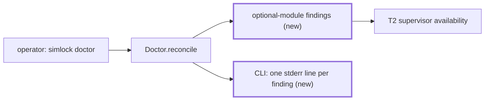
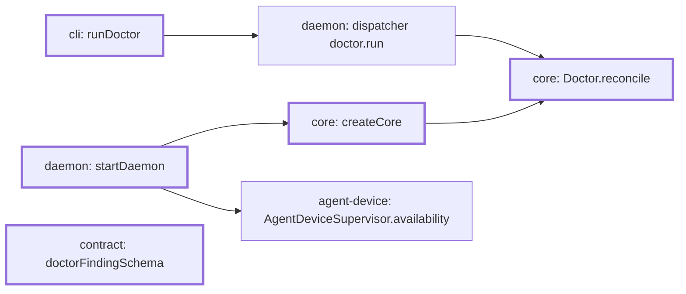

# simlock doctor says why agent-device is not available

Part of #466.

## Scope

After this PR, `simlock doctor` on a worker with `agentDevice.enabled: true` reports an `agent-device-unavailable` finding when the agent-device daemon is not running, with the reason T2's supervisor found and what to do. Example: the wrong version is installed, and doctor says which version it found and which it needs. With the edge off, starting or running, doctor reports nothing for it.

## In short



Before and after, with agent-device 0.20.3 installed and the edge on:

```
$ simlock doctor          # today
{"findings":[]}

$ simlock doctor          # after
agent-device  fail  found 0.20.3, need 0.21.25 or later; install agent-device 0.21.25 or later, then restart the daemon (`simlock daemon stop`, then `simlock daemon start`)
{"findings":[{"kind":"agent-device-unavailable","message":"found 0.20.3, need 0.21.25 or later","remedy":"install agent-device 0.21.25 or later, then restart the daemon (`simlock daemon stop`, then `simlock daemon start`)"}]}
```

| agent-device on the worker | doctor today | doctor after |
|---|---|---|
| edge off | nothing | nothing |
| edge on, running | nothing | nothing |
| edge on, still starting | nothing | nothing |
| edge on, not on `PATH` | nothing | `agent-device-unavailable`: not found, naming the command |
| edge on, too old or another RPC protocol | nothing | `agent-device-unavailable`: found and needed |
| edge on, failed to start | nothing | `agent-device-unavailable`: the cause |

The exit code stays 0, as for the other findings doctor only reports.

If this goes wrong, an operator sees no reason why agents get "agent-device is not available", or `doctor --fix` acts on a finding it cannot fix.

## Technical spec

### Modules touched



- `src/core/doctor.ts`:
  - `DoctorFinding` gains `{ kind: "agent-device-unavailable"; message: string; remedy: string }`. The kind names agent-device because the contract does; the core reads neither field.
  - `DoctorOptions` gains `optionalModules?: () => readonly OptionalModuleFinding[]`, where `OptionalModuleFinding` is `Extract<DoctorFinding, { kind: "agent-device-unavailable" }>`. The core imports nothing from `src/agent-device/`; the composition root fills the port.
  - `reconcile` appends what `optionalModules` returns, unchanged, after the warm-pool findings, on every run.
  - A throwing `optionalModules` is logged as a warning and contributes nothing, as a rejecting `advisories()` does.
  - `isDrift` excludes the kind: `--fix` never acts on it, and `doctor.reconciled`'s `driftFindings` never carries it.
- `src/core/create-core.ts`: `CoreOptions` gains `optionalModules`, passed to `Doctor`.
- `src/core/index.ts`: exports `OptionalModuleFinding`.
- `src/daemon/main.ts`: passes `optionalModules` to `createCore`. It returns one finding with T2's `message` and `remedy` when `AgentDeviceSupervisor.availability()` is `unavailable`, and none for `off`, `starting` or `running`. A gateway passes none.
- `src/contract/schemas.ts`: `doctorFindingSchema` gains the kind with `message: z.string()` and `remedy: z.string()`.
- `src/cli/index.ts`: `runDoctor` (:1378) writes one stderr line per finding, `agent-device  fail  <message>; <remedy>`, beside `writeUnreachableWarmTargets` (:1449). stdout still carries the whole report. The exit code stays 0.
- `docs/CLI.md`: the `simlock doctor` section gets a paragraph on the finding, as it has for `warm-pool-target-unreachable`.

Doctor reports problems only. A healthy agent-device prints nothing: no finding and no "ok" line, though the issue's sample shows one.

### Contract and event changes

- `doctorFindingSchema` (the `doctor.run` output) gains `agent-device-unavailable`: protocol +1 at merge. Rerun the tests of every surface that publishes `doctor.run`.
- No event changes. The finding is not drift, so `doctor.reconciled` does not carry it, and no other event fires for it.

### Other code on the same state

The state: the supervisor's availability, which this task only reads, and the doctor report.

- `AgentDeviceSupervisor` (T2) changes availability as it starts, restarts and retries. Doctor reads it once per run. A run during a start reports nothing; the next run after the start fails reports it. The supervisor wins: doctor never changes it.
- The startup doctor pass (`convergeStartup` in `src/daemon/main.ts`) also calls `reconcile`. The supervisor starts in `onSocketClaimed`, at the same time, so that pass usually sees `starting` and reports nothing. No event fires for the finding either way.
- `#applySafeFixes` acts only on drift; this kind is excluded by `isDrift`, so `--fix` and `--purge-orphans` never touch it.
- The other stderr writers in `runDoctor` (advisories, prerequisites, warm-pool targets) are unchanged and run first; the new lines follow them.
- A gateway refuses `doctor.run` (`UNSUPPORTED_IN_GATEWAY_MODE`), as today.

### Rules in play

- `architecture.md`: the core imports nothing from the edge and reads only what the port gives it; one place decides whether a finding is drift (`isDrift`).
- `documentation.md`: the printed line names no file path in this repo.
- `toolchain.md`, "Published surfaces": `doctor.run`'s schema changes, so its HTTP and CLI tests run again.

### Tests

Seam: `Doctor.reconcile` with `optionalModules`, modelled on `src/core/doctor.test.ts` ("Doctor: warm pool targets", :3099); the CLI on `src/cli/index.test.ts`; the wiring on `src/daemon/main.test.ts` with T2's scripted agent-device.

- `reconcile` returns each finding `optionalModules` gives, with its kind, message and remedy unchanged
- `reconcile` returns no `agent-device-unavailable` when `optionalModules` is omitted or returns none
- `reconcile({ fix: true })` keeps the finding in the report and changes no registry record for it
- the finding is not in `doctor.reconciled`'s `driftFindings`, and no other event is emitted for it
- the finding is returned with `prerequisites` false too
- an `optionalModules` that throws logs a warning, contributes nothing, and the other findings are still returned
- `doctorReportSchema` parses a report with the finding, and refuses one without `message` or without `remedy`
- `simlock doctor` writes `agent-device  fail  <message>; <remedy>` on stderr for the finding, prints the report on stdout unchanged, and exits 0
- `simlock doctor` writes no `agent-device` line when the report has no such finding
- `startDaemon` with `agentDevice.enabled` and an agent-device whose `--version` prints `0.20.3`: `doctor.run` reports the finding with `found 0.20.3, need 0.21.25 or later`, and an ordinary client is still granted a lease
- `startDaemon` with `agentDevice.command` found nowhere: `doctor.run` reports the finding naming the command
- `startDaemon` with `agentDevice.enabled` false, and with agent-device running, reports no `agent-device-unavailable`

## Done when

- The tests above pass.
- Removing the kind from `isDrift`'s exclusions makes the `doctor.reconciled` test fail.

## Out of scope

- What an agent sees when agent-device is not available: T4.
- Checking the agent-device version again on every doctor run: the supervisor checks at start, and the remedy says to restart.

## Depends on

- T2

## Approval

- [ ] Approved for delivery

*Written by an agent.*
