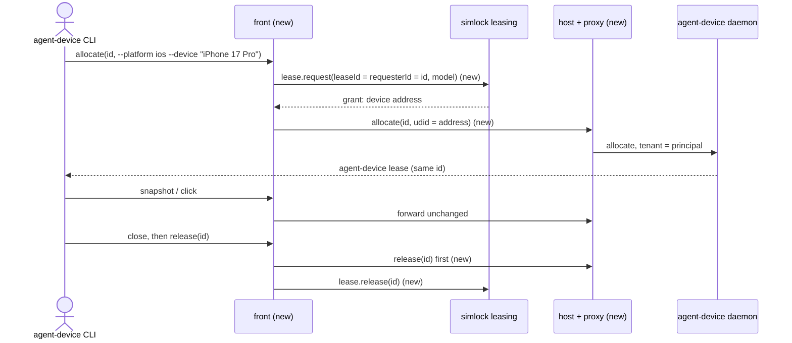
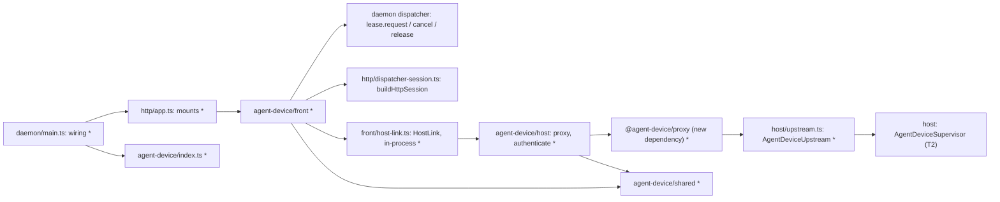
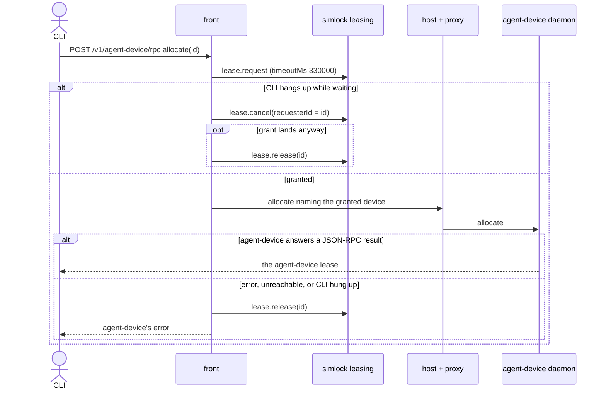

# An agent opens and closes a device through simlock

Part of #466.

## Scope

After this PR, an agent points the agent-device CLI at a simlock worker with its simlock token. `open` leases a matching device from simlock, waiting in simlock's queue when every match is taken. Commands run on that device through simlock. `close` ends the agent-device lease and then frees the simlock lease, so simlock wipes the device and offers it to the next agent. When agent-device is off or broken on the worker, every agent-device URL says so, and the rest of simlock works as before.

Heartbeats pass through to agent-device but do not yet renew the simlock lease (T5). simlock ending a lease on its own does not yet end the agent-device session (T6). The request rules after `open` and the `devices` filter come in T7.

## In short

simlock serves agent-device's proxy URL at `/v1/agent-device/*`. The **front** is the part that checks the simlock token and turns an agent-device `allocate` into a simlock `lease.request` and a `release` into a simlock `lease.release`. The **host** runs `@agent-device/proxy` in front of the agent-device daemon that T2 starts. The front reaches the host through the **host link**, in-process on a worker. The proxy's `authenticate` callback makes each simlock token's principal the agent-device **tenant**, so two tokens never share an agent-device session. One simlock lease and one agent-device lease share one ID, the 32-hex ID the CLI picks.



What the agent runs, before and after:

```
# before: simlock has no such route
$ agent-device connect proxy --daemon-base-url http://<worker>:<port>/v1/agent-device
error: 404

# after
$ export AGENT_DEVICE_DAEMON_AUTH_TOKEN=<simlock token>
$ agent-device connect proxy --daemon-base-url http://<worker>:<port>/v1/agent-device
$ agent-device open MyApp --platform ios --device "iPhone 17 Pro"
$ agent-device snapshot
$ agent-device install ./MyApp.app
$ agent-device close
$ agent-device open MyApp --platform tv
error: refused: only iOS and Android
```

How `allocate` maps to a simlock lease request. "Today" is agent-device's own proxy.

| Agent passes | Today | After |
|---|---|---|
| `--platform ios` / `android` | any device of that platform the daemon sees | `platform`; any device simlock grants |
| `--target mobile` / `tv` / `desktop` | that kind of device | `class` `phone` / `tv` / `desktop` |
| `--device "iPhone 17 Pro"` | a device named so | `model`, no `class` |
| `--device "My test phone"` (not a model) | a device named so, if one exists | `refused by simlock: <simlock's message>`, nothing leased |
| `--platform macos` / `web` / any other | allowed | `refused: only iOS and Android`, nothing asked of simlock |
| no `--platform` | the daemon picks | `refused: name --platform ios or android` |
| `--udid` / `--serial` on `open` | that device | `refused: simlock picks the device` |
| every match leased | fails at once | waits in simlock's queue, up to 330 s |
| an older CLI that sends no lease ID | allowed | `refused: this agent-device is too old for simlock; upgrade it` |

Messages the front prints, set here:

- `agent-device is not available on this simlock: <reason>`. `<reason>` is the `message` of T2's supervisor when it is `unavailable` (for example `found 0.20.3, need 0.21.25 or later`, or `agent-device 0.30.0 speaks RPC protocol 3, need 2`), and `starting` while the supervisor is still starting the agent-device daemon.
- `timed out waiting for a device; nothing was leased`.
- `refused by simlock: <simlock's message>` for any simlock refusal of the lease request.
- The refusals in the table above.

If this task goes wrong, a user notices that `open` takes a device another agent holds, that `close` leaves the device leased in `simlock list`, or that a device stays leased after the agent's CLI gave up waiting.

## Technical spec

### Modules touched





- `src/http/app.ts`:
  - `HttpGatewayDeps` (:65-84) gains an optional `mounts: readonly HttpMount[]`. `HttpMount` is `{ prefix: string; handle(request: Request, identity: TokenIdentity): Promise<Response> }`. The type names no agent-device word.
  - `createHttpApp` (:179) registers each mount at `/v1/<prefix>` and `/v1/<prefix>/*`, behind the same `agentAuth` (:190) every other route uses, after the built-in routes and before the `return` (:719). The handler passes `c.req.raw` and the identity. A worker join token is refused there, as on every `/v1` route.
  - `withConsole` (`src/http/server.ts:80-101`) already sends all of `/v1/*` to the app. No change there.
- `src/daemon/main.ts`:
  - `StartDaemonOptions` (:103-123) gains `agentDeviceUpstream?: AgentDeviceUpstream`. When it is given, main uses it and does not start T2's supervisor. Tests pass a `FakeAgentDevice` here.
  - When `agentDevice.enabled` is true, main builds the host, the in-process host link and the front map before `createLeasing` (:285), after T2's supervisor. They need nothing from leasing. The host needs `tokens`, so the `TokenStore` construction (:317, which needs only `clock`, `filesystem`, `idGenerator` and the data directory) moves above `createLeasing`. In `startHttpGateway` (:514-526) main builds the front with that front map and host link, and passes its mount to `createHttpApp`. The front gets the same `dispatch` closure and `clock` the app gets. The gateway-mode app (:729) gets no mount.
- `src/agent-device/index.ts`: exports what main needs to build the worker-mode edge in the two steps above (host, in-process host link and front map; then the front, which returns its `HttpMount`). Also exports `AgentDeviceUpstream`.
- `src/agent-device/shared/`:
  - The front's path prefix `/v1/agent-device` and the proxy's own base path `/agent-device`.
  - Parsing an `/rpc` body. It reads at most 1 MiB, the proxy's own limit. It names the call: `agent_device.lease.allocate`, `.heartbeat`, `.release` (and their `agent-device.lease.*` aliases), or anything else. For an allocate it reads `leaseId`, `ttlMs`, `platform`, `target`, `device`, `udid` and `serial` from `params`. A lease ID must be 32 lowercase hex characters.
  - The front's replies. On `/rpc`, a JSON-RPC error envelope `{ jsonrpc: "2.0", id, error: { code: -32000, message, data: { code, message } } }`, with the request's own `id`. `data.code` is `INVALID_ARGS` for a refusal and `COMMAND_FAILED` for not available or timed out. On any other route, `{ ok: false, error, code }`, the proxy's own shape. The CLI reads the body, not the status.
- `src/agent-device/front/`:
  - The request path. It first asks the host link whether agent-device is available, and answers not available with the reason if not. Then: allocate and release go to the lease code below; every other request goes to the host link unchanged, body streamed, with the client's abort signal.
  - The front map: lease ID → the principal's `TokenIdentity` and the granted device's address. An entry is added when the agent-device allocate succeeds and removed when the front releases the simlock lease. It lives in memory only.
  - Allocate. The front refuses, before simlock sees anything, the inputs the table marks refused. Otherwise it dispatches `lease.request` with the session `buildHttpSession(identity)` builds: `platform`; `class` from `--target` (`mobile` → `phone`) or `model` from `--device`, never both; `leaseId` and `requesterId` both the CLI's lease ID; `ttlMs` as the CLI sent it; `timeoutMs: 330000`, the CLI's own allocate deadline, so a client that never hangs up still leaves the queue. It sends no `allowDownload`, `physical`, `osVersion`, `mode`, `imageTag` or idempotency key. Over that wait:
    - When the request's signal aborts, the front dispatches `lease.cancel` with `requesterId` = the lease ID. A grant that resolves after the abort is released at once with `lease.release` and never sent to agent-device. This covers `cancelPending`'s `not-cancellable` answer while device work runs (`src/leasing/lease-acquisition-coordinator.ts:595-605`).
    - `QUEUE_TIMEOUT` answers `timed out waiting for a device; nothing was leased`. Any other simlock error answers `refused by simlock: <message>`.
    - After the grant, the front sends the CLI's allocate on through the host link with `device` removed and the granted device named by `grant.device.address`: `udid` on iOS, `serial` on Android. The address is what the driver read when it made the device ready (`src/core/domain.ts:229-236`): the simulator's udid on iOS (`src/drivers/ios/index.ts:874`), and the emulator's adb serial, such as `emulator-5554`, on Android (`src/drivers/android/index.ts:904`), not the AVD name in `driverDeviceId`. The front passes it on and never parses it. A grant with no address is released at once and answers a `COMMAND_FAILED` error. Only a JSON-RPC `result` counts as done, read whole (lease calls never stream). Then the front adds the map entry and answers with agent-device's reply unchanged. Anything else (an error envelope, a non-JSON body, an unreachable daemon, or the client hanging up meanwhile) makes the front release the simlock lease and answer with agent-device's reply, or a `COMMAND_FAILED` error when there is none.
  - Release. The front sends the release through the host link first. On a JSON-RPC `result` (`released` true or false; it is false after `close` ended the agent-device lease) it dispatches `lease.release` as the map entry's identity and removes the entry. `UNKNOWN_LEASE` from simlock counts as released. On anything else it keeps the simlock lease and returns agent-device's reply. A release naming a lease ID the map does not hold for this principal goes to agent-device only, and no simlock lease is touched.
  - `HostLink`: `{ status(): { state: "running" } | { state: "unavailable"; reason: string }; forward(request: Request): Promise<Response> }`, and its in-process adapter, which calls the host directly.
- `src/agent-device/host/`:
  - The host holds one proxy from `createDaemonProxy` (`@agent-device/proxy`), built when it first sees agent-device running. Options: `upstreamBaseUrl` and `upstreamToken` from `AgentDeviceUpstream`, `upstreamFetch` its `fetch`, and `authenticate`. `authenticate` reads the bearer token from `authorization`, verifies it with the same `TokenStore.verify` (`src/http/token-store.ts:109`) the HTTP app uses, and returns `{ tenantId: identity.requesterId }`, or `null`.
  - `forward` rewrites the request's path prefix `/v1/agent-device` to the proxy's base path `/agent-device`, keeping origin, query, headers, body and signal, and hands it to `proxy.handle`. The proxy serves only paths under `/agent-device` (`resolveProxyRoute` in the proxy) and builds upload tickets from the request URL. So on an `/upload/preflight` reply the host puts `/v1` back in front of the ticket URL's path. The ticket's headers already carry the agent's own token (the proxy's `authenticate` mode), so the upload `PUT` comes back through the front's normal token check.
  - `AgentDeviceUpstream` port: `current(): { state: "running"; baseUrl: string; token: string } | { state: "unavailable"; reason: string }` and `fetch(request: Request): Promise<Response>`. The real adapter reads T2's `AgentDeviceSupervisor.availability()`: `running` gives its `baseUrl` and `token`; `unavailable` gives its `message` as the reason; `starting` gives the reason `starting`. (`off` never reaches it: with the edge off there is no mount.) It uses the global `fetch`. Its in-memory fake is `FakeAgentDevice`.
- `src/agent-device/testing.ts`: `FakeAgentDevice` plays the agent-device daemon behind the real proxy. It answers `/health`, JSON-RPC lease allocate (keeping the given ID), heartbeat, release, commands including `open` and `close` (`close` ends the lease, as the real daemon does), and upload preflight and `PUT`. It checks the upstream token, records each request with its tenant, and can be set unavailable with a reason, to fail its next allocate or release, to be unreachable, or to hold a command until the test lets it go. Later tasks extend it.
- `package.json`: adds `@agent-device/proxy` as a pnpm git dependency on the pushed agent-device integration branch, pinned to one commit: `github:callstack/agent-device#<commit>&path:/packages/proxy`. It is swapped for the npm release later. T2 does not use the proxy; only this task's host does.
- `docs/HTTP-API.md`: a section for `/v1/agent-device/*`. It says how to connect, that every route needs the simlock token, that each agent needs its own simlock token, and the messages above.

Assumption: PR6's allocate takes an exact device the way other agent-device commands do, as `udid` on iOS and `serial` on Android, and its reply names that device.

Assumption: an allocate with no `platform` is refused with `refused: name --platform ios or android`, since simlock needs a platform and the CLI's allocate may send none.


### Contract and event changes

None. `src/contract/` does not change, so the protocol does not change. The front acts through `lease.request`, `lease.cancel` and `lease.release`, which emit their events as for any client. The new routes are HTTP routes outside the daemon contract.

### Other code on the same state

The state: simlock leases and lease requests the front creates, the wait queue, the front map, and the agent-device daemon's leases and sessions.

- `lease.release` from the agent's own `simlock release`, an operator's `release --all`, the expiry timer, a lost device, or startup reconcile can end a simlock lease the front created. simlock wins. The front map keeps the entry, and the front's later `lease.release` gets `UNKNOWN_LEASE`, which counts as released. The agent-device lease stays until the agent releases it or T6 lands.
- `DELETE /v1/lease-requests/:id` (`src/http/app.ts:363`) and socket `lease.cancel` can cancel the front's waiting request when sent with the same principal. The front's `lease.request` then rejects, and the front answers `refused by simlock: <message>` with nothing leased.
- `cancelPending` (`src/leasing/lease-acquisition-coordinator.ts:595-605`) refuses to cancel a request whose device work has started. The grant then lands after the hang-up, and the front releases it.
- `GET /v1/lease-requests` and `simlock list` show the front's leases and requests as ordinary ones, owned by the token's principal. Capacity and lease limits apply as for any client. The requester is the lease ID, so the one-lease-per-requester rule (`RequesterAlreadyLeasedError`) never blocks a second device for one token.
- Daemon stop: `stopAuxiliary` (`src/daemon/main.ts:476`) stops the HTTP gateway first, which aborts open requests, so the front cancels its waits. `leasing.settle` also rejects waiters. Either order ends with nothing leased by a waiting allocate.
- The agent-device daemon's state is reached only through the proxy. T2's supervisor can restart the daemon. An allocate in flight then fails, and the front releases the simlock lease.
- The HTTP request log (`src/http/app.ts:205`) logs agent-device requests like any other route.

### Rules in play

- `architecture.md` rule 9: the agent-device daemon is reached through `AgentDeviceUpstream`, faked in tests.
- `architecture.md` rule 10: `buildHttpSession` stays the one place that turns a token identity into a session; `TokenStore.verify` the one token check.
- `architecture.md` rule 11: each wait is bounded. The queue wait by `timeoutMs` 330 s from the moment the front admits the allocate. Each request through the proxy by the proxy's 5-minute upstream timeout.
- `architecture.md` rule 12: every exit from an allocate leaves the simlock lease either in the front map with an agent-device lease, or released.
- `architecture.md` rules 14, 15: the edge is entered through its `index.ts`; nothing in the core imports it.
- `safety.md` rule 10: the `/rpc` body, the lease ID and the selectors are bounded and checked before they are used.
- `testing.md` rule 2: each refusal test starts from an allocate that is granted, then changes one input.

### Tests

Seam: the whole worker daemon in-process. `startDaemon` with a `FakeDriver`, HTTP on loopback, `agentDevice.enabled`, and a `FakeAgentDevice` passed as `agentDeviceUpstream`; requests sent with `fetch`, as the CLI sends them. Model: `src/daemon/main.test.ts`, "startDaemon HTTP gateway startup readiness" (:1018-1090). New file: `src/agent-device/edge.test.ts`. The one adapter line drives the real `AgentDeviceUpstream` over T2's supervisor and its fake ports, in `src/agent-device/host/upstream.test.ts` (new), modelled on T2's `src/agent-device/host/agent-device-supervisor.test.ts`.

- with `agentDevice.enabled` false, `/v1/agent-device/health` answers 404, as today
- `/v1/agent-device/rpc` with no simlock token answers 401, and the agent-device daemon receives nothing
- `/v1/agent-device/health` with a simlock token answers the proxy's health, with the agent-device daemon's health under `upstream`
- when agent-device is unavailable, `/health`, `/rpc` and an upload each answer `agent-device is not available on this simlock: <reason>`, nothing is leased, and `POST /v1/lease-requests` still grants a device
- the real `AgentDeviceUpstream` adapter, over T2's supervisor with its fake ports, reports `running` with the supervisor's base URL and token, `unavailable` with the supervisor's `message` (`found 0.20.3, need 0.21.25 or later`), and `unavailable` with `starting` while the supervisor starts
- commands sent with two simlock tokens reach the agent-device daemon as two tenants, each its token's principal, though the client named another tenant
- allocate `--platform ios` makes a simlock lease whose ID and requester are the CLI's lease ID, owned by the token's principal, with the CLI's `ttlMs`
- allocate `--target mobile`, `tv` and `desktop` ask simlock for class `phone`, `tv` and `desktop`
- allocate `--device "iPhone 17 Pro"` asks simlock for that model and no class
- allocate `--device "My test phone"` answers `refused by simlock:` with simlock's message, and leaves no simlock lease
- allocate `--platform macos` answers `refused: only iOS and Android`, and simlock stores no lease request
- allocate with `--udid`, and with `--serial`, answers `refused: simlock picks the device`, and simlock stores no lease request
- allocate with no platform answers `refused: name --platform ios or android`, and simlock stores no lease request
- allocate with no lease ID answers `refused: this agent-device is too old for simlock; upgrade it`, and simlock stores no lease request
- a lease call whose lease ID is not 32 lowercase hex characters is refused before simlock or the agent-device daemon sees it
- after the grant, the allocate the agent-device daemon receives names the granted device's address by `udid` on iOS and by `serial` on Android (the emulator serial, not the AVD name), and carries no `device`; the CLI gets the daemon's reply with the same lease ID
- with every matching device leased, allocate waits, and is granted and answered once that device is released and reclaimed
- a CLI that hangs up while its allocate waits leaves simlock's queue, and the request is not granted when a device frees
- a CLI that hangs up after device work started for it gets no agent-device lease: the grant that lands later is released at once and never reaches the agent-device daemon
- an allocate still waiting 330 s after the front admitted it answers `timed out waiting for a device; nothing was leased`, and simlock's queue is empty
- an agent-device allocate that answers an error, that cannot reach the daemon, or whose CLI hangs up during it, and a grant that names no device address, each release the simlock lease
- release goes to the agent-device daemon first, then releases the simlock lease, and the device is reclaimed and free
- release after `close`, which the daemon answers `released: false`, still releases the simlock lease
- a release the agent-device daemon fails keeps the simlock lease and answers the daemon's error
- a release after `simlock release --all` ended the simlock lease answers the daemon's reply
- a release from a second token naming the first token's lease ID leaves the first token's simlock lease in place
- a command's reply, a streamed progress body included, reaches the CLI unchanged
- a CLI that hangs up during a forwarded command aborts the request the agent-device daemon was answering
- an upload preflight answers a ticket URL under `/v1/agent-device/upload/direct/` on simlock's own origin, carrying the agent's own simlock token, and a `PUT` to it reaches the agent-device daemon
- an `/rpc` body over 1 MiB is refused, and neither simlock nor the agent-device daemon sees it

## Done when

- Every line under Tests is a test in `src/agent-device/edge.test.ts` (the adapter line in `src/agent-device/host/upstream.test.ts`), and each fails when the behaviour it names is removed.
- With `agentDevice.enabled` true and HTTP on, `/v1/agent-device/health` with a simlock token answers the proxy's health; with it false, 404.
- An allocate followed by a release leaves the device free in `simlock list --devices`, shown by the release test.
- `docs/HTTP-API.md` documents `/v1/agent-device/*`, the one-token-per-agent rule and the messages above.
- No line needs real hardware: T9 runs these flows with the real CLI on iOS and Android.

## Out of scope

- Renewing the simlock lease on heartbeats and while a command runs, and what a heartbeat answers once a lease is gone (T5).
- Ending the agent-device session when simlock ends a lease (T6).
- Refusing other devices' selectors, `boot`, `shutdown`, routes outside a list, worker-path installs, and filtering `devices` (T7).
- Running the agent-device daemon, its version check and its policy file (T2); `simlock doctor` (T3).
- Gateway mode.

## Depends on

- T3

## Approval

- [ ] Approved for delivery

*Written by an agent.*
