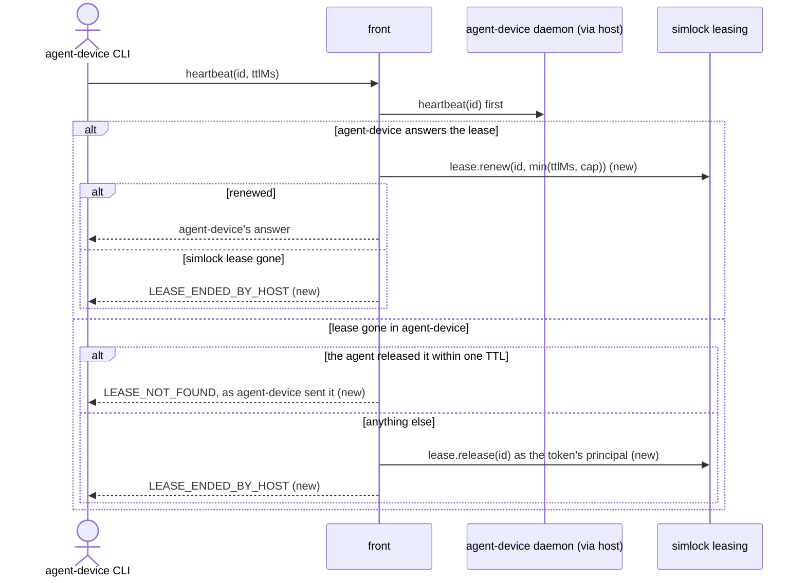
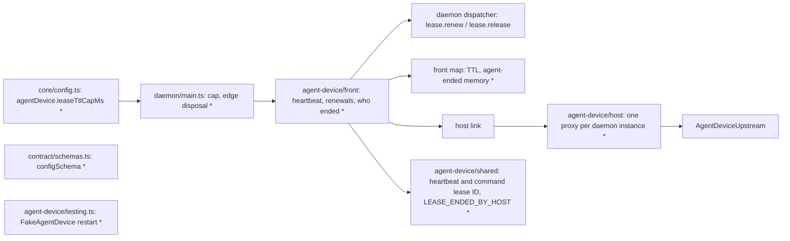

# Heartbeats keep the simlock lease alive

Part of #466.

## Scope

After this PR, an agent keeps its device while it sends commands. Each heartbeat the agent-device CLI sends renews the simlock lease, and a long command keeps it renewed until it ends. An agent that stops sending heartbeats loses the device one TTL later, 5 minutes with today's CLI. When a lease is gone for a reason the agent did not cause (simlock ended it, the agent-device daemon restarted, or the simlock daemon restarted), the agent's next command fails with `lease ended by simlock; run disconnect, then open` instead of quietly leasing a new device. A lease the agent ended itself answers "lease not found", so `close` then `open` still works. The agent's release of a lease simlock already ended answers released. After a simlock daemon restart, the agent's release also frees its old simlock lease. An operator can cap the TTL of these leases with `agentDevice.leaseTtlCapMs`, which the end-to-end suite uses to make expiry take seconds.

## In short

The CLI sends a **heartbeat** (`agent_device.lease.heartbeat`) before every command except `devices`. The front sends it to agent-device first. If agent-device answers, the front renews the simlock lease. If the lease is gone, the front answers by **who ended it**: the agent itself (a release through the front, remembered for one TTL), or anything else. While a command for a lease runs, the front renews the simlock lease every third of its TTL, and once more when the command ends, because agent-device keeps its own lease alive during a command and simlock would otherwise expire it mid-command.



What the agent sees:

```
# before (T4): heartbeats do not renew the simlock lease
$ agent-device click @e3          # 6 minutes after open, a command every minute
(the simlock lease expired at 5 minutes and simlock wiped the device under the session)

# after
$ agent-device click @e3          # keeps working while heartbeats arrive
$ simlock release --all --yes     # operator, on the worker
$ agent-device click @e3
error: lease ended by simlock; run disconnect, then open
$ agent-device close              # the agent's own close and release
$ agent-device open MyApp --platform ios   # allocates a new lease
```

| Heartbeat finds | Front answers | simlock lease |
|---|---|---|
| agent-device lease alive, simlock lease alive | agent-device's answer | renewed to now + min(ttlMs, cap) |
| agent-device lease alive, simlock lease gone (`release --all`, expiry, device lost) | `LEASE_ENDED_BY_HOST` | none to touch |
| agent-device lease gone, the agent released it through the front within one TTL | agent-device's `LEASE_NOT_FOUND` | already released |
| agent-device lease gone, any other cause (agent-device restart, simlock restart) | `LEASE_ENDED_BY_HOST` | released by ID as the token's principal |
| agent-device unreachable or any other error | that error | not renewed |
| a lease ID another token holds | `LEASE_ENDED_BY_HOST` | the other token's lease untouched |

`LEASE_ENDED_BY_HOST` is a JSON-RPC error with `data: { code: "UNAUTHORIZED", message: "lease ended by simlock; run disconnect, then open", details: { reason: "LEASE_ENDED_BY_HOST" } }`. The CLI allocates a new lease only for the reasons `LEASE_NOT_FOUND`, `LEASE_EXPIRED` and `LEASE_REVOKED` (`isInactiveLeaseError` in agent-device's `packages/contracts/src/lease-scope.ts`), so for this one it fails the command and prints the message.

If this task goes wrong, a user notices a device wiped under a running command, a lost device that the CLI silently replaced with a clean one, or `close` then `open` failing.

## Technical spec

### Modules touched



- `src/core/config.ts`: `agentDevice.leaseTtlCapMs`, optional, a positive integer number of milliseconds, unset by default. A value above `lease.maxTtlMs` is refused at load, naming the key, as `lease.defaultTtlMs` is today.
- `src/contract/schemas.ts`: `configSchema` (:776) carries `agentDevice.leaseTtlCapMs` beside T2's `agentDevice` keys.
- `src/daemon/main.ts`: passes the cap to the edge, and calls the edge's `dispose` in `stopAuxiliary` (:476) after the HTTP gateway stops.
- `src/agent-device/shared/`: for a heartbeat, reads `leaseId` and `ttlMs` from `params`. For any other `/rpc` call, reads its lease ID from `params.meta.leaseId`, else `params.flags.leaseId`, the order agent-device's own `leaseScopeFromRequest` uses. Builds the `LEASE_ENDED_BY_HOST` reply above.
- `src/agent-device/front/`:
  - The lease's TTL is `min(the CLI's ttlMs, cap)`, or the cap when the CLI sent none, or the CLI's when no cap is set. T4's allocate sends this TTL in `lease.request`. The front map stores it per lease, updated by each heartbeat.
  - Heartbeat. The front sends it through the host link first. On a JSON-RPC `result` it dispatches `lease.renew` with the stored TTL, as the map entry's identity. `UNKNOWN_LEASE` from the renew answers `LEASE_ENDED_BY_HOST`. When agent-device answers one of `LEASE_NOT_FOUND`, `LEASE_EXPIRED` or `LEASE_REVOKED`: an agent-ended entry passes agent-device's answer through; anything else dispatches `lease.release` for that ID with the requesting token's session, ignores `UNKNOWN_LEASE` and `FORBIDDEN` (simlock's own ownership check decides), and answers `LEASE_ENDED_BY_HOST`. Any other answer, including an unreachable daemon, goes back unchanged and renews nothing. A heartbeat naming a lease ID the map does not hold for this principal is "anything else" whatever agent-device answers.
  - Who ended it. Each map entry records how its lease ended: not ended, ended by the agent, or ended by simlock. T4's release, once it has released the simlock lease, marks the entry ended by the agent instead of removing it. A renewal (on a heartbeat or on the timer) that gets `UNKNOWN_LEASE`, and the "anything else" release above, mark it ended by simlock. A mark, once set, never changes. An ended entry is dropped one TTL after it ended; the front prunes on each map read and write and runs no timer for it. One function decides who ended a lease; the heartbeat, the release and T6 call it.
  - A heartbeat for an entry ended by simlock answers `LEASE_ENDED_BY_HOST` at once. Nothing goes to agent-device or to simlock.
  - A release for an entry ended by simlock. The front sends the release to agent-device and answers its reply (`released` true or false). It dispatches no `lease.release`: the simlock lease is already gone. An entry simlock ended without the front noticing still gets T4's release, whose `UNKNOWN_LEASE` counts as released.
  - A release naming a lease ID the map does not hold for this principal (as after a simlock daemon restart, when the map is empty). This replaces T4's "agent-device only" rule. The front sends the release to agent-device first. On a JSON-RPC `result` (`released` true or false) it dispatches `lease.release` for that ID with the requesting token's session, and answers agent-device's reply. simlock's own owner check refuses another principal's lease; the front ignores that `FORBIDDEN` and `UNKNOWN_LEASE`, which counts as released. On anything else from agent-device it touches no simlock lease and returns agent-device's reply.
  - Renewals while a command runs. A non-lease `/rpc` call whose lease ID the map holds for this principal counts as running from when the front forwards it until its response body ends, errors, or the client hangs up. While a lease has one or more running calls, a `Clock` timer renews it every TTL/3. When the last one ends, the front cancels the timer and renews once more. A renewal that fails cancels the timer; the call's own reply still goes back. A release through the front, and `dispose`, cancel the timer too.
- `src/agent-device/host/`: the host keeps one proxy per running agent-device daemon. When `AgentDeviceUpstream.current()` reports a token other than the proxy's, the host builds a new proxy. The new proxy has a new `instanceId`, so a CLI that sends the old one gets the proxy's 409 `Proxy instance changed` and re-reads `/health`. The restarted daemon has no leases, so each agent's next heartbeat takes the "anything else" path.
- `src/agent-device/testing.ts`: `FakeAgentDevice` can restart (new token, every lease and session gone) and can answer each lease-gone reason.
- `docs/CONFIGURATION.md`: the new key. `docs/HTTP-API.md`: the heartbeat answers and the message.

Assumption: an ended entry, either mark, is remembered for one TTL of that lease after it ended. The notes say "for a while"; one TTL covers a CLI that heartbeats the old ID right after `close`. After that, a heartbeat takes the "anything else" path and a release the no-entry path. Their answers stay the same, with one exception: a heartbeat for an agent-ended lease then answers `LEASE_ENDED_BY_HOST`.

### Contract and event changes

- `configSchema` gains `agentDevice.leaseTtlCapMs`, optional. Protocol +1 at merge.
- No event changes. Each renewal emits `lease.renewed`, and each release `lease.released` with reason `explicit`, as for any client.

### Other code on the same state

The state: each front lease's deadline and expiry timer, the front map, the renewal timers, and the agent-device daemon's leases.

- `LeaseLifecycle#renew` (`src/leasing/lease-lifecycle.ts:128`) is also reached by the agent's own `POST /v1/leases/:id/renew` or socket `lease.renew`. Each moves the deadline; the last one wins, and neither shortens a lease the other just renewed past its TTL.
- The expiry timer, `release --all`, a lost device and startup reconcile end the simlock lease; simlock wins. A renewal timer that fires after that gets `UNKNOWN_LEASE` and cancels itself. The next heartbeat answers `LEASE_ENDED_BY_HOST`. The agent-device session stays until T6's participant ends it, or until the agent runs `disconnect`, whose release answers as above.
- Startup reconcile after a simlock daemon restart (ADR 0019) ends leases whose device is not running and restores the expiry timers of the rest. The front map is empty after a restart, so the first heartbeat for a surviving lease releases it; a lease nobody heartbeats expires at its deadline.
- T2's supervisor restarts a dead agent-device daemon and reports its new token. The host's proxy follows it (above).
- The agent-device daemon renews its own lease on each admitted request and protects it while a command runs. Its lease ceiling is far above simlock's (T2), so it outlives the simlock lease.
- Daemon stop: `stopAuxiliary` stops the HTTP gateway, which ends every running call, then disposes the edge, which cancels any timer left.

### Rules in play

- `architecture.md` rule 5: renewal is a direct call from the front's request path and its timer, never an event handler.
- `architecture.md` rule 10: one function decides who ended a lease; heartbeat and later tasks call it.
- `architecture.md` rule 12: every exit of a running call (end, error, hang-up, release, failed renewal, dispose) leaves its lease's renewal timer either armed for a running call or cancelled.
- `safety.md` rule 10: a lease ID from the wire is acted on only through simlock's own ownership checks.
- `testing.md` rule 2: assert on the lease's deadline, not on counts of timers or calls the test does not own.

### Tests

Seam: the whole worker daemon in-process with a `FakeClock`, a `FakeDriver`, HTTP on loopback and a `FakeAgentDevice`, as T4 set up in `src/agent-device/edge.test.ts`; requests sent with `fetch`. Model: that file and `src/daemon/main.test.ts` (:1018-1090). The config key: `src/core/config.test.ts`.

- a heartbeat reaches the agent-device daemon before simlock, and once it answers, the simlock lease's deadline is now plus the CLI's `ttlMs`
- a heartbeat the agent-device daemon cannot answer returns that error and leaves the simlock lease's deadline where it was
- a heartbeat for a lease the agent released through the front answers `LEASE_NOT_FOUND`, and a following allocate gets a new lease
- one TTL after the agent's release, a heartbeat for that lease answers `LEASE_ENDED_BY_HOST`
- after `simlock release --all`, after expiry, and after the device is lost, a heartbeat for the lease answers `LEASE_ENDED_BY_HOST` with the message and reason above, and makes no new simlock lease
- a heartbeat the agent-device daemon answers `LEASE_NOT_FOUND`, `LEASE_EXPIRED` or `LEASE_REVOKED`, for a lease simlock holds and the agent did not release, releases the simlock lease and answers `LEASE_ENDED_BY_HOST`
- a heartbeat naming a lease ID the front map lacks, which simlock holds for this token's principal, releases that simlock lease and answers `LEASE_ENDED_BY_HOST`
- a heartbeat from a second token naming the first token's lease ID answers `LEASE_ENDED_BY_HOST`, and the first token's lease is neither released nor renewed
- after a heartbeat answered `LEASE_ENDED_BY_HOST` because simlock ended the lease, the next heartbeat answers it again and the agent-device daemon receives nothing for it
- a release for a lease simlock ended answers the agent-device daemon's reply as a success, and the agent-device lease is released
- while a command for the lease runs longer than its TTL, the simlock lease is renewed every TTL/3 and does not expire
- when the command ends, the lease is renewed once more, and its deadline does not move again over the next TTL
- a command that fails, and one whose CLI hangs up, stop the renewals the same way
- with two overlapping commands on one lease, renewals go on until the second one ends
- a renewal that fails because simlock ended the lease mid-command stops the renewals, and the command's reply still reaches the CLI
- a command naming a lease ID the front map does not hold for its token starts no renewals
- a release through the front while a command runs stops that lease's renewals
- a lease whose CLI stops sending heartbeats expires one TTL after its last heartbeat, and its device can be leased again
- with `agentDevice.leaseTtlCapMs` set below the CLI's `ttlMs`, the simlock lease, each heartbeat's renewal and the renewal interval use the cap
- after the agent-device daemon restarts, a request with the old proxy instance ID answers 409 `Proxy instance changed`, and the next heartbeat answers `LEASE_ENDED_BY_HOST` and releases the simlock lease
- after a simlock daemon restart on the same data directory, a heartbeat for a lease made before the restart answers `LEASE_ENDED_BY_HOST` and releases that simlock lease
- after a simlock daemon restart on the same data directory, a release for a lease made before the restart answers the agent-device daemon's reply as a success and releases that simlock lease
- a release with no map entry from a second token, naming the first token's lease ID, answers the agent-device daemon's reply and leaves the first token's simlock lease in place
- stopping the daemon while a command runs leaves no renewal timer armed
- (config) `agentDevice.leaseTtlCapMs` is unset by default, accepts a positive integer, and refuses zero, a fraction and a value above `lease.maxTtlMs`, naming the key
- (config) `config.get` returns `agentDevice.leaseTtlCapMs` when it is set

## Done when

- Every line under Tests is a test, and each fails when the behaviour it names is removed.
- A heartbeat after `simlock release --all` answers `lease ended by simlock; run disconnect, then open`, and a heartbeat after the agent's own release answers `LEASE_NOT_FOUND`.
- A command longer than the lease's TTL keeps its simlock lease, shown with a fake clock.
- `docs/CONFIGURATION.md` lists `agentDevice.leaseTtlCapMs`, and `docs/HTTP-API.md` the heartbeat answers.
- No line needs real hardware: T9 runs the expiry, agent-device restart and simlock restart scenarios on iOS and Android.

## Out of scope

- Ending the agent-device session when simlock ends a lease (T6). Until then a session simlock ended stays until the agent's `disconnect`.
- Releasing simlock leases whose agents never heartbeat again after a restart; they expire at their TTL.
- Restarting the agent-device daemon (T2).

## Depends on

- T4

## Approval

- [ ] Approved for delivery

*Written by an agent.*
