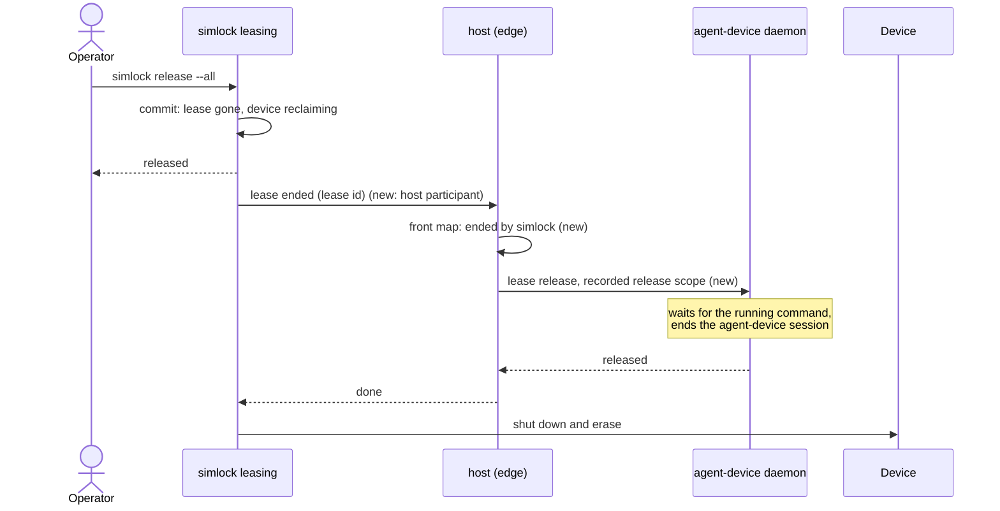
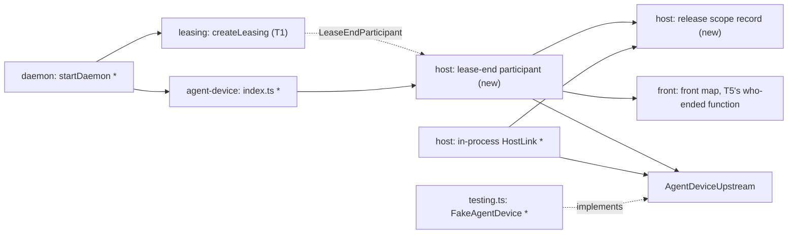

# simlock ending a simlock lease ends the agent-device session first

Part of #466.

## Scope

After this PR, when simlock ends a simlock lease that an agent got through
agent-device (`simlock release --all`, expiry, device lost, an operator's
release), the agent-device session on that device ends before simlock wipes
it. A command still running there finishes first, up to `lease.endWaitMs`.
The agent's next command fails with "lease ended by simlock", and the next
agent gets a clean device that agent-device does not still hold.

Before this PR, simlock ends the simlock lease and wipes at once. The
agent-device lease and its agent-device session stay behind in the
agent-device daemon, so the device claim stays, and the next agent's `open`
on that device fails with `DEVICE_IN_USE`.

## In short

simlock already knows how to wait before a wipe (T1: the
`LeaseEndParticipant` port, with the `lease.endWaitMs` ceiling). This task
plugs the edge into it. The host releases the agent-device lease with the
same scope the agent's own release would carry. agent-device then waits for
the running command, ends the agent-device session and clears its device
claim before it answers (agent-device PR #3480). Only then does the wipe
start.

New term:

- **release scope:** the fields agent-device checks before it releases a
  lease: tenant, run ID, and the lease provider, client ID and device key
  the lease was allocated with. Example: tenant `tok_ci1`, run ID
  `proxy-3f2a…`, lease provider `proxy`. A release that lacks one of them is
  refused with `LEASE_SCOPE_REQUIRED`.



```
# before: the operator ends everything while agent A runs a command
$ simlock release --all --yes
# the device is erased under A's running command; then agent B:
$ agent-device open MyApp --platform ios
error: DEVICE_IN_USE ...

# after
$ simlock release --all --yes
# A's command finishes, A's agent-device session ends, then the wipe
$ agent-device snapshot            # agent A
error: lease ended by simlock; run disconnect, then open
$ agent-device open MyApp --platform ios      # agent B, once the wipe is done
# opened on that device
```

If this goes wrong, a user would see an app erased under a running command,
a device that stays `reclaiming` for 10 minutes when nothing runs on it, or
the next agent's `open` failing with `DEVICE_IN_USE`.

## Technical spec

### Modules touched



(`*` = changed, `new` = new file.)

- `src/agent-device/host/` gains the lease-end participant and the release
  scope record (lease id → release scope). Suggested file:
  `src/agent-device/host/lease-end.ts`.
- The in-process `HostLink` adapter (T4) fills the record:
  - When agent-device answers an allocate with a lease, the host records
    that lease's release scope. It reads it from the lease in the allocate
    reply (`tenantId`, `runId`, `leaseProvider`, `clientId`, `deviceKey`),
    not from the request. The proxy overwrites the tenant, so the reply is
    what agent-device stored.
  - When agent-device answers a release from the agent with a result
    (`released` true or false), the host drops the entry. An error answer
    keeps it.
  - While a release from the agent is in flight, the host keeps its promise
    under the lease id, so the participant can wait for it.
- The participant, for each lease T1 hands it:
  1. Returns at once when the record has no entry for the lease id: the
     lease was not the edge's, or the agent already released it.
  2. Marks the lease "ended by simlock" in the front map, through T5's
     who-ended function. A mark already set (T5) is never overwritten.
  3. If a release from the agent is in flight for the lease, waits for it
     and sends no second release.
  4. Otherwise sends the normal `agent_device.lease.release` with the full
     recorded release scope through `AgentDeviceUpstream`, straight to the
     agent-device daemon with its daemon token. It does not use the
     agent-device daemon's admin lease `DELETE`. It does not go through the proxy: the
     proxy's `authenticate` needs the agent's simlock token, which the host
     never holds.
  5. Drops the entry, whatever the outcome. An error from agent-device is
     thrown to T1, which logs it and reclaims.
  6. Aborts its request when T1's signal fires (ceiling passed, daemon stop,
     maintenance).
- The front already answers from the mark (T5): a heartbeat for an entry
  ended by simlock answers `LEASE_ENDED_BY_HOST` at once, and the agent's
  release of it asks simlock for nothing. This task only sets the mark.
- `src/agent-device/index.ts` exports what `startDaemon` needs to register
  the participant.
- `src/daemon/main.ts`: with `agentDevice.enabled` true, `startDaemon`
  passes the participant in `leaseEndParticipants` to `createLeasing`. With
  it false, it passes none. T4 already builds the host and the front map
  before `createLeasing`, so the participant is built from them there and
  nothing moves.
- `src/agent-device/testing.ts`: `FakeAgentDevice` gains what agent-device
  PR #3480 does and the tests need:
  - a release refuses a missing or wrong release scope with `UNAUTHORIZED`,
    reason `LEASE_SCOPE_REQUIRED` or `LEASE_SCOPE_MISMATCH`;
  - a release of a lease with a held command answers only after the command
    is let go;
  - a release can be made to hang until its signal aborts. (Failing a
    release, an unreachable daemon and `released: false` for an unknown
    lease are T4's.)

T1's participant call carries an abort signal that fires when the ceiling
passes, on graceful stop and on maintenance. T5's front map keeps an ended
entry for one TTL after it ended; the "ended by simlock" mark lives in that
entry.

One request through the hop, with the failure reply:

```mermaid
sequenceDiagram
  participant L as simlock leasing (T1)
  participant P as host participant
  participant U as AgentDeviceUpstream
  participant D as agent-device daemon

  L->>P: lease ended {leaseId, owner, deviceId, platform, reason}, signal
  alt no record for the lease
    P-->>L: done at once
  else recorded
    P->>U: POST /rpc agent_device.lease.release {leaseId, tenantId, runId, leaseProvider, clientId, deviceKey}
    U->>D: forward with the daemon token
    alt a command still runs
      D->>D: wait for it, end the agent-device session
    end
    alt ok
      D-->>P: {released: true or false}
      P-->>L: done
    else error or unreachable
      D-->>P: JSON-RPC error
      P-->>L: throws; T1 logs and reclaims
    else T1's signal fires
      P->>U: abort the request
      P-->>L: done; T1 reclaims
    end
  end
```

Facts this relies on, read from the agent-device code (branch
`fix/session-ends-with-lease`, PR #3480):

- `lease_release` releases the registry entry first. It then awaits
  `endSessionsForLease` before it replies (`src/daemon/handlers/lease.ts`).
  That runs `endLeaseSessions` under each session's execution locks
  (`src/daemon/lease-lifecycle.ts`), so a running command finishes first.
  The device claim is cleared even when teardown fails.
- A release of an unknown lease answers `{released: false}`, not an error
  (`LeaseRegistry.releaseLease`).
- `getLease` refuses a release without tenant and run ID, or without a
  lease provider, client ID or device key the lease has
  (`assertLeaseOwnerScope`, `assertLeaseScopeMatch` in
  `src/daemon/lease-registry-scope.ts`). The proxy CLI allocates with lease
  provider `proxy`, a client ID and run ID `proxy-<clientId>`
  (`src/cli/connection/proxy-profile.ts`), so all of them are needed.

### Contract and event changes

None. Searched `src/contract/`: no operation, schema or error code changes.
No event is added or changed; `lease.released` still fires when the end is
committed.

### Other code on the same state

- **T1's lease-end runner** (in `src/leasing/`) calls the participant for
  every ending: release, release-all, expiry, device lost, startup. At
  startup after a simlock daemon restart, the record is empty, so the
  participant returns at once for every lease. T1's ceiling and stop signal
  win over the participant: when they fire, it aborts and returns.
- **The agent's own release** (T4's release path through the host). The
  agent's release goes to agent-device first, then simlock leasing calls the
  participant. The host dropped the entry when agent-device answered, so the
  participant sends nothing. If simlock ends the lease while that release
  is still in flight, the participant waits for it (step 3). Whichever
  answers first, agent-device gets one release, and the wipe waits for it.
- **T5's front map "ended by the agent" mark.** The host dropped the record
  entry when agent-device answered the agent's release, before the front
  released the simlock lease. So the participant returns at step 1 and sets
  no mark. Agent wins.
- **T5's heartbeat path.** A heartbeat that arrives after the commit and
  before the participant runs finds no mark yet. T5's own rule answers it
  (agent-device or simlock says the lease is gone, not ended by the agent:
  `LEASE_ENDED_BY_HOST`). Both orders give the agent the same answer.
- **T5's renew loop** (every TTL/3 while a command runs). After the commit,
  its renew finds the simlock lease gone, and T5 handles that as today.
- **T5's agent-device daemon restart.** The new daemon knows no old lease,
  so the participant's release answers `released: false` and the wipe
  starts at once. The record is not cleared on restart; each entry goes when
  its simlock lease ends.
- **agent-device's own expiry sweep** (PR #3480, every second). The
  agent-device lease has the same TTL as the simlock lease. If agent-device
  ended it first, the participant's release answers `released: false`. If
  the participant got there first, agent-device's sweep finds nothing.
- **`LeaseReleaseCoordinator.releaseAllDuringMaintenance`** (`nuke`) and
  graceful stop: T1 tells participants to stop; the participant aborts its
  request.
- **T4's late grant release and failed agent-device allocate.** Neither
  reaches a successful agent-device allocate, so neither has a record entry.
  The participant does nothing for them.

### Rules in play

- `architecture.md` rule 5: the wait is a direct call through the port,
  never a `lease.released` handler.
- Rule 11: the release to agent-device crosses a process. Its only bound is
  T1's signal; the participant adds no timer of its own that restarts.
- Rule 12: every exit of the participant drops the record entry, and leaves
  no request open after T1's signal.
- Rule 15: leasing holds only the neutral port; nothing in `src/leasing/`
  imports the edge.
- `safety.md` rule 10: the release scope comes from agent-device's own
  allocate reply. Check its fields' shape and length before storing them.
- `testing.md` rule 2: a test that the wipe waits must first show the wipe
  is held, then let the command go and show it starts.

### Tests

Seam: the whole daemon in-process (`startDaemon` with a `FakeDriver` and a
`FakeClock`), the agent's calls over HTTP with `fetch` to
`/v1/agent-device/*`, `FakeAgentDevice` behind `AgentDeviceUpstream` through
`StartDaemonOptions`, and operator calls (`lease.release-all`,
`lease.release`) over the socket as admin. Model: T4's `src/agent-device/edge.test.ts` and `src/daemon/main.test.ts`
(:1018-1090). Tests go in `src/agent-device/edge.test.ts`.

- release-all while an agent holds a device sends agent-device a release with the agent's principal as tenant and the run ID, lease provider, client ID and device key of the allocate reply
- release-all: the driver's reclaim of the device starts only after agent-device answers that release
- a command still running at release-all finishes before the driver's reclaim of that device starts
- while the host waits for that release, the device stays `reclaiming` and a second agent's open for the same model is not granted it
- once the reclaim ends, a second agent's open is granted that device
- a simlock lease that expires sends agent-device the same release before its reclaim starts
- an operator's `lease.release` of the agent's lease sends agent-device the same release before its reclaim starts
- after release-all, the agent's next heartbeat answers LEASE_ENDED_BY_HOST and sends nothing to agent-device
- the agent's own release then sends agent-device no second release when simlock leasing ends the lease
- release-all while the agent's own release is still in flight waits for it, sends no second release, and reclaims after it answers
- an agent holding two devices: release-all sends one release per lease, each with that lease's scope
- a simlock lease from a plain client, with the edge on, ends with nothing sent to agent-device and its reclaim starts at once
- with agentDevice.enabled false, release-all reclaims at once, as today
- agent-device answering the release with an error: the device's reclaim still starts
- agent-device unreachable for the release: the device's reclaim still starts
- after the agent-device daemon restarts, release-all gets released false from it and the reclaim starts at once
- a command held past lease.endWaitMs: the reclaim starts at the ceiling and the host's release request is aborted
- a daemon stop while the host waits for a release aborts that request and does not wait for the command
- `nuke.run` while the host waits for a release aborts that request and the reset goes on
- FakeAgentDevice refuses a release without the run ID with LEASE_SCOPE_REQUIRED, as agent-device does
- FakeAgentDevice answers a release of a lease with a held command only after the command is let go

## Done when

- Every Tests line above passes with `pnpm exec vitest run --project unit <file>`.
- `rg "agent-device" src/leasing src/core` finds nothing.

## Out of scope

- The port, its ceiling, its stop signal and the `lease.endWaitMs` config key
  (T1).
- The front map, its ended marks and the answers they give, the agent's
  release after simlock ended a lease, and agent-device daemon restarts
  (T5).
- Proving it on real devices: the release-all scenarios in T9's worker-mode
  suite do that.
- Gateway mode: there the front sits on another daemon and cannot be marked
  in-process. The heartbeat rule of T5 answers alone.

## Depends on

- T1
- T5

## Approval

- [ ] Approved for delivery

*Written by an agent.*
