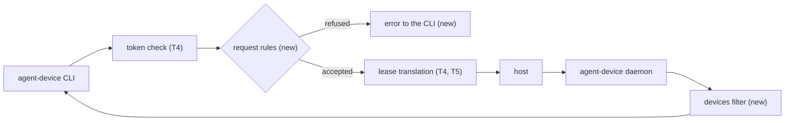
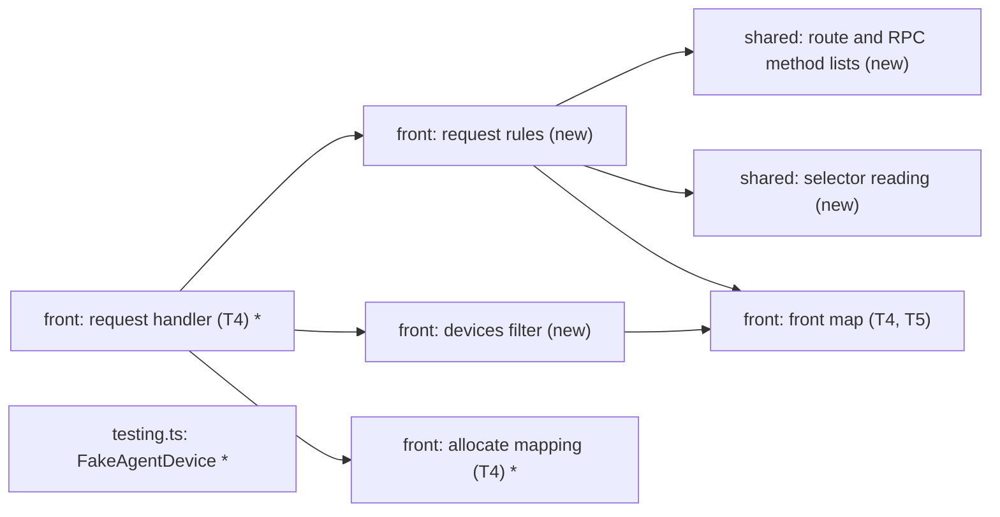
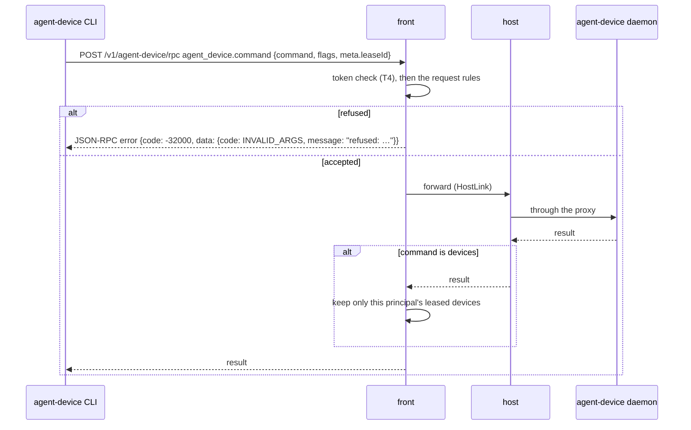

# The agent-device front refuses requests that reach past the agent's device, and `devices` lists only its own

Part of #466.

## Scope

After this PR, the front refuses every agent-device request that would reach
past the device simlock granted the agent: a platform other than iOS or
Android, a device selector naming any other device, a device set or Android
allowlist of the agent's own, a route or RPC method outside a fixed list, and
an `install` or `reinstall` of a path on the worker. A sharded `test` with no
`--device` runs on the devices this token holds. `devices` answers only
the devices this simlock token holds. Before this PR, all of these reach the
agent-device daemon, which picks any device it can see.

## In short

The front checks each request before it reaches the host. A refused request
never reaches agent-device and never touches a simlock lease. An accepted one
goes on as today. One accepted request is changed on its way: a sharded
`test` with no `--device` gets the token's leased devices added.

New terms:

- **leased device** (of a request): the device in the front map entry for
  the lease the request names in `meta.leaseId`, when the request's principal
  holds that lease. Example: agent A's `snapshot` names lease `9f3c…`, whose
  entry holds the iPhone 17 Pro with UDID `A1B2…`. A request that names no
  lease, or another principal's lease, has no leased device.
- **the token's leased devices:** the devices of every front map entry
  whose lease the request's principal holds and has not ended.
- **device selector:** a request field that picks a device: `udid`,
  `serial`, `device` (a name, or for `test` a comma list of names and ids).
  Example: `agent-device screenshot --udid A1B2…` sends `flags.udid`.



```
# before (no rules: the agent-device daemon decides)
$ agent-device screenshot --udid <agent B's device>
# screenshot of agent B's device
$ agent-device install MyApp remote:/Users/ci/MyApp.app
# installs a file from the worker's disk
$ agent-device devices --platform ios
# every simulator simlock manages

# after
$ agent-device screenshot --udid <agent B's device>
error: refused: simlock picks the device
$ agent-device install MyApp remote:/Users/ci/MyApp.app
error: refused: send the app from your machine as an upload
$ agent-device open MyApp --platform web
error: refused: only iOS and Android
$ agent-device devices --platform ios         # before open
(no devices)
$ agent-device open MyApp --platform ios --device "iPhone 17 Pro"
$ agent-device devices --platform ios
iPhone 17 Pro   booted   <udid>
```

| Request | Today | After |
|---|---|---|
| `--platform ios` / `android` | passes | passes |
| `--platform web`, `macos`, `apple`, `vega`, `linux`, `harmonyos` | passes | refused: only iOS and Android |
| `--udid` / `--serial` of the leased device | that device | passes |
| `--udid` / `--serial` of any other device | that device | refused: simlock picks the device |
| `--udid` / `--serial` before `open` (no leased device) | that device | refused |
| `--device "iphone 17 pro"`, the leased device's model in any letter case | that name | passes |
| `--device` with the leased device's own name, or its id | that device | passes |
| `--device` naming another model or device | that device | refused |
| `test --device a,b`, every entry one of the token's leased devices | both | passes |
| `test --device <leased udid>,<another token's udid>` | both | refused |
| `test --shard-all 2` or `--shard-split 2` with no `--device` | any booted devices | passes, with `--device <the token's leased devices>` added |
| the same, from a token that holds no device | any booted devices | refused: no device leased; run open first |
| `batch` with a step that has `udid` of another device | that device | refused, no step runs |
| `--ios-simulator-device-set <any dir>`, on any command (also when saved at `connect proxy`) | that set | refused: simlock chooses the device set; run disconnect, then connect proxy without --ios-simulator-device-set |
| `--android-device-allowlist <any ids>`, on any command (also when saved at `connect proxy`) | that list | refused: simlock chooses the devices; run disconnect, then connect proxy without --android-device-allowlist |
| `install ./MyApp.app` (an upload: `meta.uploadedArtifactId` set) | installs | passes |
| `install MyApp remote:/path`, or a path missing on the agent's machine | reads the worker path | refused: send the app from your machine as an upload |
| `reinstall` without an upload | reads the worker path | refused |
| `batch` with an `install` or `reinstall` step | reads the worker path | refused |
| `batch` with a `devices` step | every device | refused: run devices on its own |
| `devices` before `open` | every device | empty list |
| `devices` after `open` | every device | only the devices this token holds |
| `boot`, `shutdown` | allowed | refused by agent-device's policy file (T2), as before this PR |
| `install-from-source` with a URL source | allowed | passes, as today |
| a route outside the list, e.g. `GET /v1/agent-device/admin/leases` | proxy answers 404 | refused, 404 |

If this goes wrong, a user would see an agent screenshot, install on or click
another agent's device, an app installed from a file on the worker, or
`devices` listing other agents' devices. Or, the other way, a legitimate
`open --device "iPhone 17 Pro"` or `install ./MyApp.app` refused.

## Technical spec

### Modules touched



(`*` = changed, `new` = new file.)

- `src/agent-device/shared/`: the route list, the RPC method list, and the
  reading of selector flags from RPC params. Suggested files: `routes.ts`
  and `selectors.ts`. If T4 already holds a route list there, this task
  extends it rather than adding a second one.
- `src/agent-device/front/`: the rules (suggested `request-rules.ts`), and
  the `devices` filter (suggested `devices-filter.ts`). The front's request
  handler (T4) calls the rules after its token check and before its lease
  translation, and the filter on a `devices` answer.
- T4's allocate mapping checks the platform and refuses `udid` and `serial`.
  Both checks move into the rules, with T4's messages, and T4's tests for
  them pass unchanged. The mapping reads the values the rules accepted, so
  each rule lives in one place. Its no-platform, no-lease-ID and
  unknown-model answers stay in T4.
- The front map entry. T4's entry holds the granted device's address, which
  is the leased device's id. This task adds the device's model (the grant's
  `spec.model`) and its name (from agent-device's allocate reply) when the
  entry is made.
- `src/agent-device/testing.ts`: `FakeAgentDevice` (it already records every
  request, T4) answers `devices` with a list the test gives it.

The rules, in this order. The first refusal answers.

1. **Route.** `/v1/agent-device` followed by one of these, else 404:

   | Method | Path |
   |---|---|
   | GET | `/health` |
   | POST | `/rpc` |
   | POST | `/upload`, `/upload/preflight`, `/upload/finalize` |
   | PUT | `/upload/direct/<id>` |
   | GET | `/artifacts`, `/artifacts/<path>` |
   | GET | `/sessions/<session>/requests/<request id>/diagnostics` |

   This is the list `@agent-device/proxy` forwards (`isSupportedDaemonRoute`
   in `packages/proxy/src/daemon-proxy.ts`), read against the CLI's URLs:
   it joins `health`, `rpc` and `upload/...` onto the daemon base URL
   (`src/daemon-client/daemon-client-transport.ts`,
   `src/remote/upload-client.ts`). Match by path segments, not by prefix.
2. **RPC method.** On `/rpc`, `method` is one of, else refused:
   `agent_device.command`, `agent_device.lease.allocate`,
   `agent_device.lease.heartbeat`, `agent_device.lease.release`,
   `agent_device.install_from_source`,
   `agent_device.release_materialized_paths`, and each with `-` in place of
   the first `_` (the daemon accepts both spellings,
   `src/daemon/server/http-rpc-methods.ts`).
3. **Where selectors are read.** For `agent_device.command`: `params.flags`,
   and for `params.command` `batch`, also each entry of
   `params.flags.batchSteps` (its `input` and its `flags`). For
   `agent_device.lease.allocate`: the top-level params. For
   `agent_device.install_from_source`: `params.platform`. A selector field
   present with a value that is not a string (or, for the shard flags, not
   an integer) is refused.
4. **Platform.** `platform`, when present, is `ios` or `android`. Anything
   else is refused: "refused: only iOS and Android".
5. **Device set and allowlist.** `iosSimulatorDeviceSet` present, with any
   value, on any command, allocate or batch step, is refused: "refused:
   simlock chooses the device set; run disconnect, then connect proxy without
   --ios-simulator-device-set". `androidDeviceAllowlist` the same: "refused:
   simlock chooses the devices; run disconnect, then connect proxy without
   --android-device-allowlist". The CLI saves both flags at `connect proxy`
   and sends them on every command, so the message says how to clear them.
6. **Device selectors.**
   - `udid` and `serial` pass only when equal to the leased device's id: the
     udid or serial the front sent the CLI in the allocate reply.
   - A device **matches** when the entry equals its id exactly, or its
     model or its own name compared the way agent-device compares device
     names (`matchesDeviceNameSelector` in agent-device's
     `packages/kernel/src/device.ts`: letter case ignored, `_` read as a
     space, runs of spaces read as one, ends trimmed).
   - `device` on any command but `test` passes only when it matches the
     leased device. Another model is refused.
   - `device` on `test` is split on `,`; each entry is trimmed and empty
     ones dropped, as agent-device does (`explicitShardDeviceSelectors`,
     `packages/replay-port/src/daemon-port/session-test-shard-devices.ts`).
     It passes only when every entry matches one of the token's leased
     devices, the same set rule 7 fills in. Any other entry refuses it.
   - A request with no leased device refuses any `udid`, `serial`, or
     `device` on a command other than `test`. A `test` list is checked
     against the token's leased devices whether or not the request names a
     lease. One more exception: an allocate's `device` is the model to ask
     for, and T4's mapping answers it. An allocate's `udid` or `serial` is
     refused.
   - The front map entry still answers after the lease ended, so a request
     naming the device of a lease simlock just ended passes this rule, and
     agent-device's "lease gone" answer reaches the CLI.
   - Refusal: "refused: simlock picks the device".
7. **Sharding.** A `test` with `shardAll` or `shardSplit` and no `device`
   list is not refused. The front sets `flags.device` to the ids of the
   token's leased devices, joined with `,`, and forwards it; without that,
   agent-device would pick devices from everything its daemon sees. This is
   the only rule that edits a request instead of passing or refusing it.
   When the token holds no device, it is refused: "refused: no device
   leased; run open first". A list the agent sent is checked by rule 6
   against the same set. The list the front fills in is not checked again:
   it names only this token's devices.
8. **Install.** `install` or `reinstall` without a non-empty string
   `meta.uploadedArtifactId` is refused: "refused: send the app from your
   machine as an upload". The CLI uploads a local file and sets that id; it
   sends `remote:<path>`, or a path missing on the agent's machine, as a
   plain positional (`prepareRemoteInstallPackage` in
   `src/remote/daemon-artifacts.ts`). A `batch` step `install` or
   `reinstall` is always refused: a step carries no upload.
9. **Batch `devices`.** A `batch` step `devices` is refused: "refused: run
   devices on its own".

A `batch` step goes through rules 4 to 9 as a command does, with its own
selectors. The first step refused refuses the whole batch, and no step runs.

The `devices` filter. An `agent_device.command` with `command: "devices"`
that passed the rules goes on to agent-device. The daemon answers
`result.data.devices`, a list of entries with an `id`
(`devicesInventoryResponse` in
`src/daemon/session-lifecycle/internal/inventory.ts`). The front keeps only
the entries whose `id` is the device id of a lease the request's principal
holds in the front map and that has not ended. An error answer passes
unchanged. An ok answer without a readable list answers an empty list.

Refusals on `/rpc` answer with T4's refusal reply, built by T4's shared
reply code: the JSON-RPC error envelope with the request's `id`,
`error.code` -32000, and `error.data` `{ code: "INVALID_ARGS", message }`,
the message being the refusal text. A route refusal answers HTTP 404 with
T4's other-route shape `{ ok: false, error: <text>, code: "INVALID_ARGS" }`.

Assumption: agent-device's allocate reply names the device with the `name`
its `devices` list shows for it, as it names the device's id.

Assumption: an allocate carries the CLI's selectors as top-level params
(`platform`, `target`, `device`, and `udid` or `serial` when given), as
`readLeaseAllocateProviderFlags` already reads `platform` and `device`
(`packages/contracts/src/lease-scope.ts`). The agent-device change that
sends `target` is not written yet.

Assumption: `--platform apple` is refused. It is agent-device's alias for
any Apple device, macOS included; agents pass `ios`.

One request through the hop, with the refusal:



### Contract and event changes

None. Searched `src/contract/`: no operation, schema or error code changes;
the refusals are agent-device wire answers on `/v1/agent-device/*`. No
event is added or changed.

### Other code on the same state

- **T4's token check** runs first, so a route outside the list without a
  token answers 401, not 404. Token check wins.
- **T4's allocate mapping** maps `platform`, `target` and `device`, and
  answers an unknown model. The rules run before it, so a refused allocate
  never calls `lease.request`. The platform and `udid`/`serial` checks are
  in the rules only.
- **The front map** (T4 writes it, T5 and T6 mark ended entries). The rules
  and the filter only read it. The filter skips ended entries; rule 6 does
  not, for the reason in rule 6.
- **`@agent-device/proxy`'s own checks**, after the front: its route 404,
  and its refusal of an install source of kind `path` without an upload
  (`carriesUnbackedHostPathInstallSource`,
  `packages/proxy/src/install-source-admission.ts`). The front refuses
  first, with simlock's text. These are agent-device's checks, not a second
  copy in simlock.
- **The agent-device daemon's policy file** (T2) refuses `boot` and
  `shutdown`, batch steps included (`assertDaemonPolicyAdmitsRequest`,
  `src/daemon/daemon-policy.ts`). The rules do not repeat it.
- **agent-device refusing a request's own device set or allowlist when the
  operator set one** (assumed landed). The front refuses them first; the
  daemon's refusal stays as a second product's check.
- **Upload tickets.** The proxy writes the caller's own credential into the
  preflight answer; the `PUT /upload/direct/<id>` then passes the token
  check and rule 1. Nothing here changes it.

### Rules in play

- `safety.md` rule 10: every request field is a claim. Parse it, check its
  type, compare whole values; never by prefix or substring. Unknown
  routes, methods and selector shapes fail closed.
- `architecture.md` rule 10: each rule is in one place. The platform and
  `udid`/`serial` checks leave T4's mapping.
- Rule 14: the rules and the filter stay inside `src/agent-device/`; nothing
  outside imports them.
- `testing.md` rule 2: each refusal test first sends the accepted request
  and shows it reaches agent-device, then changes one field.

### Tests

Seam: the whole daemon in-process (`startDaemon` with a `FakeDriver`), the
agent's calls over HTTP with `fetch` to `/v1/agent-device/*`,
`FakeAgentDevice` behind `AgentDeviceUpstream` through
`StartDaemonOptions`. Model: T4's `src/agent-device/edge.test.ts` and
`src/daemon/main.test.ts` (:1018-1090). Tests go in
`src/agent-device/edge.test.ts`. Each
refusal test asserts the refusal text and that `FakeAgentDevice` received
nothing for it.

- each route in the list, with a token, reaches agent-device
- `GET /v1/agent-device/admin/leases` is refused 404 and reaches nothing
- `POST /v1/agent-device/health` is refused 404
- a route outside the list without a token answers 401
- an unknown RPC method is refused; `agent-device.command` with a dash is forwarded
- a command with `--platform android` is forwarded; with `macos` or `apple` it is refused
- a batch step with `platform: web` is refused and no step reaches agent-device
- a command with `--udid` of its own leased device is forwarded; with agent B's device's udid it is refused
- a command with `--serial` of its own leased emulator is forwarded; with another serial it is refused
- `--device` with the leased device's model in other letter case, with its own name, and with its id are each forwarded; another model is refused
- `test --device <own udid>,<own model>` is forwarded; for an agent holding two devices, `test --device <udid A>,<udid B>` is forwarded; with one entry naming another token's device it is refused
- a command with `--udid` and no `meta.leaseId` is refused
- a command naming agent B's lease in `meta.leaseId` with that lease's udid is refused
- an agent holding two devices: a command for lease A with lease B's udid is refused
- a batch step with another device's udid is refused and no step reaches agent-device
- a `udid` that is a number is refused
- `--ios-simulator-device-set` naming simlock's own device set is refused with the disconnect-and-reconnect message, on a command and on an allocate
- `--android-device-allowlist` is refused with its disconnect-and-reconnect message, on a command and in a batch step
- `test --shard-all 2` with no `--device` reaches agent-device with `device` set to the token's leased devices, for an agent holding one device and for one holding two
- `test --shard-split 2` with no `--device`, from a token that holds no device, is refused with "refused: no device leased; run open first"
- after simlock ended the lease, a command with that lease's udid is forwarded and agent-device's answer reaches the CLI
- `install` with `meta.uploadedArtifactId` is forwarded; the same without it is refused with "send the app from your machine as an upload"
- `reinstall` without `meta.uploadedArtifactId` is refused
- a batch step `install` is refused and no step reaches agent-device
- `install_from_source` with a URL source is forwarded, as today
- `devices` before open answers an empty list while agent-device lists three devices
- `devices` after open answers only the leased device; agent B's device is left out
- `devices` for an agent holding two devices answers both; an error answer from agent-device passes unchanged
- a batch step `devices` is refused
- `boot` is forwarded to agent-device, whose policy file answers it (T2), as before this PR

## Done when

- Every Tests line above passes with `pnpm exec vitest run --project unit <file>`.
- A request refused by each of rules 1 to 9 shows the refusal in the test
  output and no matching entry in `FakeAgentDevice`'s received requests.
- A sharded `test` with no `--device` reaches `FakeAgentDevice` with the
  token's leased devices as its `device`.

## Out of scope

- Selectors inside the script files `replay` and `test` read (`.ad` and
  Maestro flows): the front does not parse them. agent-device's own check
  that a command acts only on its lease's device closes this.
- Other flags that read or write worker files (`--out`, `--artifacts-dir`,
  `--steps-file`, Metro and XCTest paths): an accepted gap in #466.
- A selector flag agent-device adds later: it passes until agent-device
  refuses it itself.
- Refusing `boot` and `shutdown`: T2's policy file.
- Mapping `--platform`, `--target` and `--device` to a simlock lease
  request, and the unknown-model answer: T4.
- Proving it on real devices: T9's refusal scenarios.

## Depends on

- T6

## Approval

- [ ] Approved for delivery

*Written by an agent.*
