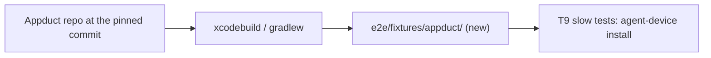
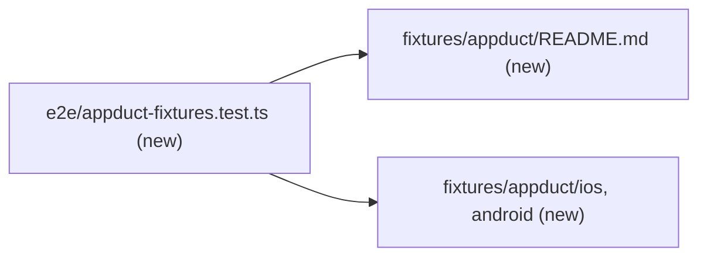

# Commit prebuilt Appduct playground apps as end-to-end fixtures

Part of #466.

## Scope

After this PR the repo holds two ready-made sample apps: an iOS simulator
build and an Android debug build of Appduct's native playground. Both are
built from one pinned Appduct commit. The agent-device slow tests (T9) install
them without building an app or downloading anything.

## In short

Today simlock's repo has no app to install, so a test cannot show that an
agent's `install` of a local app works through simlock. This task adds two
built apps under `e2e/fixtures/appduct/`, with a README that says where they
came from and how to build them again.

A **fixture app** here is a built app committed to the repo for tests, for
example `e2e/fixtures/appduct/android/AppductPlayground.apk`.



If this goes wrong: no simlock user notices. T9's slow tests fail at
`install`, or cannot find the screen ids they `click`.

## Technical spec

### Modules touched

- `e2e/fixtures/appduct/README.md` (new)
- `e2e/fixtures/appduct/ios/AppductPlayground.app/` (new, about 1.6 MB)
- `e2e/fixtures/appduct/android/AppductPlayground.apk` (new, about 10 MB)
- `e2e/appduct-fixtures.test.ts` (new, fast e2e lane)



The source:

- Repo: `https://github.com/callstackincubator/appduct`.
- Pin: tag `v0.15.0`, commit `0e68131bdd4b8a789314812caf1995b496c52ae9`.
  It is the newest release. It holds the last `playground-native` change
  (`7edfa7d`) and the last native SDK change (`0963162`).
- The builds in the local `../cordierite` checkout are older than the pin.
  Do not copy them; build fresh at the pin.

Build commands (they go in the README word for word):

```bash
# iOS, from playground-native/ios at the pin (needs Xcode and xcodegen)
xcodegen generate
xcodebuild build -project AppductPlayground.xcodeproj -scheme AppductPlayground \
  -configuration Debug -sdk iphonesimulator \
  -destination 'generic/platform=iOS Simulator' -derivedDataPath build \
  ARCHS=arm64 CODE_SIGNING_ALLOWED=NO
# -> build/Build/Products/Debug-iphonesimulator/AppductPlayground.app

# Android, from playground-native/android at the pin (needs JDK 17 and ANDROID_HOME)
./gradlew :app:assembleDebug
# -> app/build/outputs/apk/debug/app-debug.apk, committed as AppductPlayground.apk
```

The README says:

- the repo, the tag and the full commit;
- the build commands above, and where each output is copied;
- the tool versions used for this build (Xcode, xcodegen, JDK, Android SDK
  platform);
- the app ids: iOS `com.callstack.appduct.playgroundnative`, Android
  `com.callstack.appduct.playground`;
- the screen ids T9 uses, from Appduct's playground contract: `tab-tools`,
  `tab-status`, `connection-state`, `call-count`;
- that the iOS build runs on arm64 simulators only (Apple silicon Macs);
- a table of every fixture file with its SHA-256;
- how to refresh: build at a new pin, replace the files, update the pin and
  the table in the same commit.

Debug builds are used on both platforms, as Appduct's own device suite does.
The iOS build is unsigned; the arm64 linker signs it ad hoc, which the
simulator accepts. The Android build is signed with the builder's debug key.

### Contract and event changes

None. Searched: the change touches no file under `src/`.

### Other code on the same state

Searched for `fixtures`, `.gitattributes`, LFS and the globs that reach `e2e/`:

- No `e2e/fixtures/` directory exists today. No `.gitattributes` and no git
  LFS in the repo. The files go in as ordinary git blobs. The repo's pack is
  35.7 MiB today; this adds about 11.5 MB, and every refresh adds as much
  again to history.
- `vitest.config.ts` e2e project includes `e2e/**/*.test.ts`. Only the new
  test file matches; the fixture directory holds no test file.
- `lefthook.yml` formats staged `*.{ts,tsx,js,mjs,json,md,yml,yaml}`. It
  formats the README. The built bundle holds only `Info.plist`, `PkgInfo`,
  the executable and its debug dylibs, so no fixture file matches.
- `package.json` `files` ships only `dist`, so the fixtures never reach the
  npm package.
- `e2e/tsconfig.typecheck.json` includes `**/*.ts`; no fixture file is
  TypeScript. Fallow reads only JS and TS sources.

Nothing else reads or writes these paths.

### Rules in play

- `testing.md`: the checksum test must go red when a fixture byte or a
  README hash changes.
- `safety.md`: no implicit downloads. The apps are committed, so no test
  fetches one.
- `documentation.md`: the README is a maintainer file under `e2e/`, not an
  end-user doc.

### Tests

Seam: a fast-lane vitest file that reads the fixture directory and its
README; it starts no daemon. Model: the `describe`/`it` shape of
`e2e/helpers/cli.test.ts`.

- every file under `e2e/fixtures/appduct/` except the README is listed in
  the README's table, and its SHA-256 matches the one listed
- the README's table lists no file that is missing from
  `e2e/fixtures/appduct/`
- the README names the Appduct repo and a full 40-character commit

## Done when

- `pnpm test:e2e e2e/appduct-fixtures.test.ts` passes.
- On a Mac:
  `plutil -extract CFBundleIdentifier raw e2e/fixtures/appduct/ios/AppductPlayground.app/Info.plist`
  prints `com.callstack.appduct.playgroundnative`, and
  `lipo -info e2e/fixtures/appduct/ios/AppductPlayground.app/AppductPlayground`
  names `arm64`.
- With the Android SDK: `aapt dump badging e2e/fixtures/appduct/android/AppductPlayground.apk`
  (from `$ANDROID_HOME/build-tools/<version>/`) names package
  `com.callstack.appduct.playground`.
- `git ls-remote https://github.com/callstackincubator/appduct v0.15.0`
  prints the commit the README names.
- That both apps install and run on real devices is proven by T9's slow
  tests, not here.

## Out of scope

- A script or CI job that rebuilds the apps. The README's commands are the
  record.
- Release builds, and Appduct's Expo and Flutter playgrounds.
- git LFS.
- Any test that installs the apps (T9).

## Depends on

## Approval

- [ ] Approved for delivery

*Written by an agent.*
