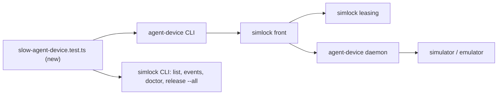
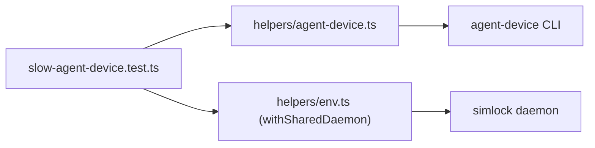
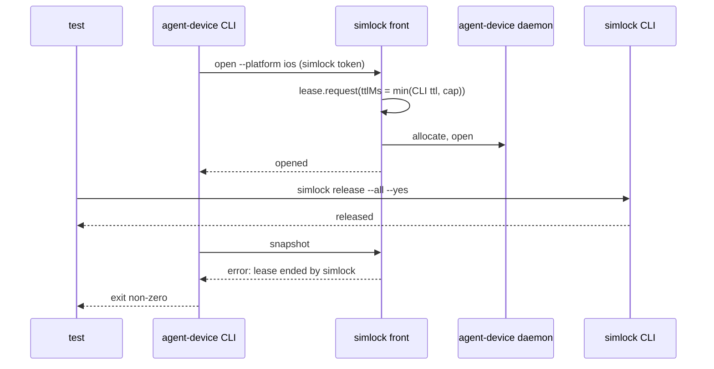

# End-to-end tests: agent-device through a simlock worker on real iOS and Android devices

Part of #466.

## Scope

After this PR, one slow-lane test file proves every Completion condition of
#466 on a real simulator and a real emulator. It runs the real simlock
daemon, the real agent-device daemon under simlock, and the real
agent-device CLI. The CLI comes from a local build of agent-device's
integration branch. The file is `e2e/slow-agent-device.test.ts`.

The idle-expiry tests set T5's `agentDevice.leaseTtlCapMs`, so they take
seconds instead of 5 minutes. This task adds no config key and no product
code.

## In short

Each platform gets one simlock daemon for the whole file, serving HTTP on
loopback with the agent-device edge on. Each test creates its own agents.
An **agent** in these tests is one agent-device CLI with its own `HOME` and
its own simlock token, connected with
`agent-device connect proxy --daemon-base-url http://127.0.0.1:<port>/v1/agent-device`.
Tests check the CLI's exit code and JSON output, and simlock's own
`list`, `events` and `doctor`.

If this goes wrong: no simlock user notices at once. A break in the
agent-device flow on real devices goes unseen until a user hits it.

## Technical spec

### Modules touched

- `e2e/slow-agent-device.test.ts` (new): one `describe` per platform.
- `e2e/helpers/agent-device.ts` (new): makes an agent (temp `HOME`, a new
  agent token from `token create --role agent`, `connect proxy`); runs a CLI
  command with `--json`; starts one in the background with a handle to
  kill it; removes the agents' homes and kills their background CLIs after
  each test, from a module-level `afterEach`, as `env.ts` does.
- `e2e/helpers/env.ts`: `withSharedDaemon(options)`. Same options and
  `TestEnv` as `withDaemon`, but torn down once, in a module-level
  `afterAll`, through the existing `teardown()`. It never enters
  `activeEnvs`.
- `e2e/helpers/index.ts`: exports the two helpers.
- `docs/internal/agent-rules/toolchain.md`: a machine-check row for this
  file (below).
- `e2e/README.md`: its claim that only two files touch a real emulator.

One request through the processes, with the failure reply:

Every shared daemon starts with:

- `http.enabled: true`, `http.host: "127.0.0.1"`, a port from
  `freeLoopbackPort()`;
- `agentDevice.enabled: true`, `agentDevice.command` = the path in
  `SIMLOCK_E2E_AGENT_DEVICE`. The same path is every agent's CLI. It is
  `bin/agent-device.mjs` in a build of the agent-device integration branch,
  at the commit simlock's `@agent-device/proxy` dependency pins (T4). That
  build reports `0.21.25-dev`, which T2 accepts;
- `capacity.config.limits.<platform>.maxDevices: 1` and `maxRunning: 1`, so
  "the only device" is one known device;
- `driver: "real"`, so it has its own device root and adb server port.

Before the first test it leases one device with plain
`simlock lease --detach --platform 
`, releases it, and waits for it to be
`ready`. No `open` then pays a cold create inside the CLI's 5.5-minute
allocate deadline.

Tests that need other config wrap their body in `env.withConfig(...)`, which
restarts the daemon and restores the config after. Those that raise the
device limit run last.

The fixture apps come from T8: `e2e/fixtures/appduct/ios/AppductPlayground.app`
and `e2e/fixtures/appduct/android/AppductPlayground.apk`.

The new row in `toolchain.md`'s machine checks:

| Line needs | Check |
|---|---|
| agent-device through simlock | the iOS or the Android check; `SIMLOCK_E2E_AGENT_DEVICE` is the absolute path of `bin/agent-device.mjs` in a checkout of agent-device's integration branch at the commit simlock's `@agent-device/proxy` dependency pins, built with `pnpm install && pnpm build`; iOS on Apple silicon (the fixture app is arm64 only); room for two running devices of the platform. Run `scripts/slow-e2e.sh e2e/slow-agent-device.test.ts` |

Each `describe` is skipped when `SIMLOCK_E2E_AGENT_DEVICE` is unset or its
platform check fails. A set path that does not exist fails the test.

T2 reads the version with `<agentDevice.command> --version`, after it checks
the install's layout. So the wrong-version test builds a temp package that
passes that check: `package.json` naming `agent-device`, an empty
`dist/src/daemon.js`, and an executable `bin/agent-device.mjs` that prints
`0.9.2` for `--version` and exits 0. `agentDevice.command` points at that
`bin/agent-device.mjs`.

T2's pid record is `<SIMLOCK_HOME>/agent-device-daemon.json`, with a `pid`
field. The test reads the agent-device daemon's pid from it.

Assumption: agent-device runs `wait <ms>` under the session's execution lock,
so a lease release waits for it (agent-device PR #3480). If it does not, the
running-command test uses a device-reading command that runs as long.

Assumption: every agent-device CLI command is its own process, and the
agent-device session lives in the daemon. So "an agent whose CLI is killed
mid-session" is tested as an agent that sends no more commands.

The tests use agent-device's command names `click` and `press`, never
`tap`: `click 'id="tab-status"'`.

Tests assert the messages T4 to T7 set: `lease ended by simlock; run
disconnect, then open`, `agent-device is not available on this simlock:
<reason>`, and the `refused: …` texts. For `boot` and `shutdown` it is
agent-device's policy denial: `UNAUTHORIZED` with `details.reason`
`DAEMON_POLICY_DENIED`.

### Contract and event changes

None. The task touches no file under `src/`. No event changes.

### Other code on the same state

- `e2e/helpers/env.ts` `activeEnvs` and its `afterEach`: shared envs are kept
  in their own set, so the per-test teardown never stops a shared daemon.
  `withConfig` and `restartDaemon` work on a shared env as on any other.
- `scripts/slow-e2e.sh`: one slow run per machine; this file runs only
  through it, one file at a time.
- `e2e/helpers/ios-device-set.ts` `emptyDeviceSet`: the shared teardown
  empties the iOS device set as the per-test one does.
- The agent-device daemon's pid record (T2): the test only reads it.

### Rules in play

- `testing.md`: each title is a claim the body proves. Each refusal starts
  from the same request accepted, then changes one thing. The
  running-command test must go red when the wipe starts before the command
  ends.
- `safety.md`: no implicit downloads (no test asks for one); tests never
  touch the user's devices (own `SIMLOCK_HOME`, adb port, agent `HOME`s).
- `toolchain.md`: the slow lane runs only through `scripts/slow-e2e.sh`.
- `architecture.md`: every wait on another process has a deadline.

### Tests

Seam: the slow lane, real processes, through `scripts/slow-e2e.sh`; model
`e2e/slow-android-smoke.test.ts` and `e2e/slow-ios-slim.test.ts`.

Slow tests. Each runs in the iOS `describe` (tags `slow`, `ios`) and in the
Android `describe` (tags `slow`, `android`), in this order:

- an agent opens a device, installs the Appduct fixture app as an upload,
  opens it, takes a snapshot that shows `tab-status`, clicks `tab-status`,
  saves a PNG screenshot and closes; the device is then not `leased` in
  `simlock list --devices`
- `devices` lists nothing before `open`, and only the device `open` bound
  after it
- `close` releases the simlock lease before the CLI exits (one read of
  `simlock list --leases`, no polling), and a following `open` works
- after an accepted upload `install` and `snapshot`, `install` from a
  `remote:` path, `boot`, `shutdown` and `snapshot --ios-simulator-device-set <dir>`
  (Android: `--android-device-allowlist <serial>`) are refused, and the
  device is still leased and answers `snapshot`
- `simlock release --all` ends the agent's agent-device session and the
  device is wiped; another agent's `open` then gets that same device (the
  same `deviceId` in `simlock list --leases`), where opening the fixture app
  fails because the wipe removed it; the first agent's next command fails
  with "lease ended by simlock"
- a `wait 20000` running when `simlock release --all` is called exits 0 after
  at least 20 s, and the wipe starts after it exits (the `device.reclaimed`
  timestamp minus its duration)
- with the only device leased, a second agent's `open` waits in
  `simlock list --requests`; killing its CLI empties the queue, and once the
  device is free no `lease.granted` names that request's requester while a
  third agent's `open` gets the device
- when the agent-device daemon is killed, a new one with a new pid runs; the
  agent's next command fails with "lease ended by simlock", and its simlock
  lease is released
- after the simlock daemon is killed and started again, the old agent-device
  daemon's pid is gone; the agent's next command fails with "lease ended by
  simlock", and its old simlock lease is released
- with `agentDevice.leaseTtlCapMs` 20000, an agent that sends no more
  commands gets `lease.expired` at most 25 s after its last command, and
  another agent's `open` then gets the device
- with `agentDevice.leaseTtlCapMs` 20000, after a graceful simlock daemon
  restart an old simlock lease whose agent sends nothing gets
  `lease.expired` at most 25 s after its last renewal
- with `agentDevice.command` pointing at an agent-device that reports
  `0.9.2`, the daemon starts and grants a plain `simlock lease --detach`; an
  agent's `open` fails with `agent-device is not available on this simlock:
  found 0.9.2, need 0.21.25 or later`; `simlock doctor` reports
  `agent-device-unavailable` with `found 0.9.2, need 0.21.25 or later`
- with the device limit raised to 2, two agents on two tokens get two
  different devices (two `deviceId`s in `simlock list --leases`); B's `snapshot` naming its own device is accepted and
  naming A's (`--udid`, Android `--serial`) is refused; after B's `close`,
  A's `snapshot` still works

Completion conditions of #466, each to its test:

| Completion condition | Test |
|---|---|
| connect, `open`, `snapshot`, `click`, `screenshot`, `install`, `close`; device free | "an agent opens a device, installs ..." |
| two agents, two tokens; B's `--udid` of A's device refused | "with the device limit raised to 2, two agents ..." |
| `devices` empty before `open`, only the leased device after | "`devices` lists nothing before `open` ..." |
| `release --all` ends the session before the wipe; next agent gets the device; first agent's next command fails | "`simlock release --all` ends the agent's agent-device session ..." |
| a running command finishes before the wipe | "a `wait 20000` running when ..." |
| a killed CLI loses its lease within the idle limit; device leasable | "with `agentDevice.leaseTtlCapMs` 20000, an agent that sends no more commands ..." |
| queue wait; killing the CLI removes the request, never granted | "with the only device leased, a second agent's `open` waits ..." |
| `close` frees the lease at once; next `open` works | "`close` releases the simlock lease before the CLI exits ..." |
| agent-device daemon killed: restarted, next command fails, lease released | "when the agent-device daemon is killed ..." |
| simlock daemon restart: released on next command or expire | "after the simlock daemon is killed and started again ..." and "... after a graceful simlock daemon restart ..." |
| remote install, `boot`, `shutdown`, `--ios-simulator-device-set` refused | "after an accepted upload `install` and `snapshot` ..." |
| wrong agent-device version: simlock runs, agents told, doctor says why | "with `agentDevice.command` pointing at an agent-device that reports `0.9.2` ..." |

## Done when

- On a Mac with an iOS runtime, Apple silicon and `SIMLOCK_E2E_AGENT_DEVICE`
  set: `scripts/slow-e2e.sh e2e/slow-agent-device.test.ts` passes every test
  in the iOS `describe` of `e2e/slow-agent-device.test.ts`.
- On a machine where `command -v emulator adb` finds both and
  `SIMLOCK_E2E_AGENT_DEVICE` is set: the same command passes every test in
  the Android `describe`.
- With `SIMLOCK_E2E_AGENT_DEVICE` unset, both `describe`s are skipped, not
  failed.

## Out of scope

- Gateway mode and its tests.
- Physical devices.
- Running the slow lane in CI.
- Pinning agent-device as a dev dependency; that waits for its release.
- New error messages: the tests use the ones T2 to T7 merged.

## Depends on

- T7
- T8

## Approval

- [ ] Approved for delivery

*Written by an agent.*
