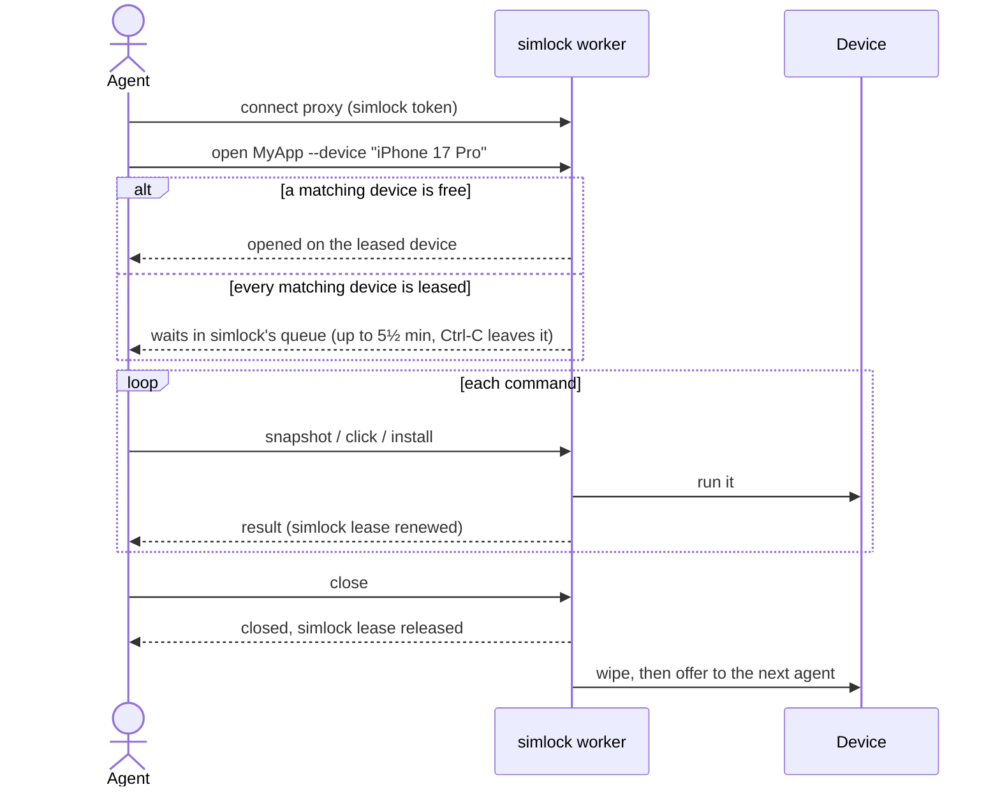
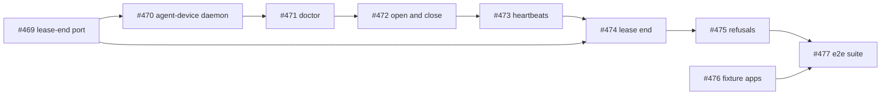

Request: none

## Problem

An agent that drives apps with agent-device can't share a machine's devices
safely with other agents. Run directly, agent-device picks a device itself.
It can take one another agent has leased from simlock, or one simlock is
wiping. Leasing from simlock first and passing the device by hand leaves two
leases that nobody keeps in step. The simlock lease can expire while
commands still run, and simlock then wipes the device under the agent.

## Who it is for

Coding agents that run the agent-device CLI on a machine where simlock
manages the simulators and emulators. Also the operator who runs simlock
there and turns this on.

## Outcome

An agent points the agent-device CLI at a simlock worker, with its simlock
token, and uses it as it would any agent-device proxy.

- simlock picks a device that matches what the agent asked for. No other
  agent can take it while the agent holds it.
- While the agent sends commands, its simlock lease stays alive.
- When the agent runs `close` or `disconnect`, or simlock ends the simlock
  lease, the agent-device session on that device ends first. Then simlock
  wipes the device and offers it to the next agent.
- The operator installs agent-device and turns it on in simlock's config.
  When it does not work, `simlock doctor` says why.

This feature covers an agent connected to the worker that owns the device.
Connecting through a gateway is a separate feature that builds on this one.

It needs agent-device changes that are not released yet:

- a lease ID the caller chooses;
- `open` sending what device it wants, and the reply naming the device;
- an agent-device session ending with its agent-device lease;
- a daemon-wide iOS device set, and refusing a different set a request
  brings;
- the proxy taking the tenant from simlock's token check;
- the CLI releasing its agent-device lease after `close`;
- uploads resuming through the proxy. simlock relies on them and builds no stand-ins. Until
agent-device releases them, simlock is built and tested against a local
agent-device build that has them.

## How it works for the user



When simlock ends the simlock lease itself:

```mermaid
sequenceDiagram
  actor Agent
  participant S as simlock worker
  participant D as Device

  Note over S: idle 5 min, release --all, device lost, or simlock restart
  opt an agent's command is still running
    S->>S: wait until it ends (at most 10 min)
  end
  S->>D: end the agent-device session, then wipe
  Agent->>S: next command
  S-->>Agent: error: lease ended by simlock; run disconnect, then open
```

The operator, once:

```
$ simlock doctor                      # agent-device works: nothing about it
$ simlock doctor                      # too old a version installed
agent-device is not available on this simlock: found 0.20.3, need 0.21.25 or later
```

The agent. Before this feature there is no way to do this through simlock.
After:

```
$ export AGENT_DEVICE_DAEMON_AUTH_TOKEN=<simlock token>
$ agent-device connect proxy --daemon-base-url http://<worker>:<port>/v1/agent-device
$ agent-device devices --platform ios
(no devices)
$ agent-device open MyApp --platform ios --device "iPhone 17 Pro"
$ agent-device devices --platform ios
iPhone 17 Pro   booted   <udid>
$ agent-device snapshot
$ agent-device install ./MyApp.app
$ agent-device close
$ agent-device open MyApp --platform ios      # a clean device, maybe another one
```

What the agent sees when something is refused or fails:

```
$ agent-device open MyApp --udid <another device>
error: refused: simlock picks the device

$ agent-device install MyApp remote:/Users/ci/MyApp.app
error: refused: send the app from your machine as an upload

$ agent-device shutdown
error: refused: simlock manages power

$ agent-device open MyApp --platform ios      # every device leased for 5½ min
error: timed out waiting for a device; nothing was leased

$ agent-device click @e3                       # after simlock ended the lease
error: lease ended by simlock; run disconnect, then open

$ agent-device open MyApp                      # agent-device off or broken on the worker
error: agent-device is not available on this simlock: found 0.20.3, need 0.21.25 or later
```

The exact wording of each message is set when the work is planned.

## Examples

Choosing a device. "Today" is agent-device's own proxy; "After" is through
simlock.

| Agent passes | Today | After |
|---|---|---|
| `--platform ios` | any iOS device the daemon sees | any iPhone simlock grants |
| `--platform ios --target tv` | an Apple TV | an Apple TV simlock grants |
| `--device "iPhone 17 Pro"` | a device named so | that model, newest iOS installed |
| `--device "My test phone"` (not a model) | a device named so, if one exists | refused by simlock: unknown model |
| `--udid` / `--serial` of the leased device | that device | that device |
| `--udid` / `--serial` of any other device | that device | refused |
| `--device "iPhone 17 Pro"` on a later command, holding an iPhone 17 Pro | that device | the leased device |
| `--device "iPhone 16"` on a later command, holding an iPhone 17 Pro | a device named so | refused |
| `--platform web` / `macos` | allowed | refused: only iOS and Android |
| `--ios-simulator-device-set <dir>` | uses that set | refused |
| `--android-device-allowlist <ids>` | uses that list | refused |
| either flag saved by `connect proxy` | used on every command | every command refused: run disconnect, then connect proxy without it |
| OS version, tablet, watch, vision | no flag | no flag; simlock's defaults apply |

Commands:

| Command | Today | After |
|---|---|---|
| `boot`, `shutdown` | allowed | refused: simlock manages power |
| `install ./MyApp.app` (upload) | allowed | allowed |
| `install MyApp remote:/path` | allowed | refused |
| `settings`, `permissions`, `test`, `record` | allowed | allowed; the wipe undoes them |
| `devices` | every device the daemon sees | only the devices this simlock token holds |
| `test --shard-all 2` with no `--device` | every booted device the daemon sees | only the devices this simlock token holds |
| `batch` | each step runs | each step checked like a command; `install`, `reinstall` and `devices` steps refused |

## What could go wrong

- Two agents sharing one simlock token see and can close each other's
  agent-device sessions. Likely in CI setups that hand one token to many
  agents. The docs say each agent needs its own token.
- An agent that thinks for more than 5 minutes between commands loses its
  device and its installed app. Likely for slow agents.
- A stuck command holds a device the operator released for up to 10
  minutes. Rare.
- Some flags (output paths, Metro and XCTest paths) can still read or write
  files on the worker machine. Rare, and only as the simlock user.
- `open` can boot a device that simlock thinks is shut down. Rare.
- agent-device's maintainers turn down or reshape one of the changes this
  relies on. The feature then waits, or its design changes.
- If simlock cannot reach agent-device to end an agent-device lease, that
  device refuses agent-device's `open` until the agent disconnects or for
  up to a day. Rare; a simlock restart clears it.

## Words used

- **simlock lease:** a device reserved in simlock for one principal, with a
  time limit, e.g. the iPhone an agent got from `simlock lease`.
- **agent-device lease:** agent-device's own "this device is mine for now"
  record; every agent-device command is checked against it.
- **agent-device session:** what `agent-device open` starts and `close`
  ends: the device in use, the open app, the last snapshot.
- **simlock token:** the secret a client sends to simlock; it names a
  principal.
- **principal:** who a simlock token belongs to, e.g. `ci-agent`.
- **worker:** a simlock daemon that owns the devices on its own machine.
- **gateway:** a simlock daemon that owns no devices and passes requests to
  workers.
- **agent-device proxy:** the agent-device URL an agent connects to with
  `agent-device connect proxy`; here, served by the simlock worker.
- **wipe:** what simlock does to a device after a simlock lease ends: shut
  it down and erase it, so the next agent starts clean.

## Non-goals

- Connecting through a gateway. A separate feature, built on this one.
- Physical devices.
- Platforms other than iOS and Android.
- Choosing a device by OS version, or asking for a tablet, watch or vision
  device.
- A new limit on how many devices one simlock token holds. simlock's own
  lease limits apply.
- Keeping agents that share one simlock token apart.
- Stopping agent-device run outside simlock from touching simlock's devices,
  as simlock does not stop raw `simctl` or `adb` today.
- Marking these leases as agent-device in `simlock list` or the console.
  They are ordinary simlock leases.
- Keeping a device across `close` and `open`.
- Working with agent-device releases that lack the changes listed under
  Outcome. simlock builds no stand-ins for them.

## Completion conditions

Each is checked by a scripted end-to-end run on one machine, on iOS and
Android, against prebuilt sample apps, with an agent-device build that has
the changes listed under Outcome.

- An agent connects, runs `open`, `snapshot`, `click`, `screenshot`,
  `install` of a local app and `close`. Afterwards the device shows as free
  in `simlock list --devices`.
- Two agents with two simlock tokens each get their own device and their
  own agent-device session. Agent B naming agent A's device with `--udid` is
  refused.
- Before `open`, `devices` lists nothing; after it, only the leased device.
- `simlock release --all` ends the agent's agent-device session before the
  device is wiped. Once the wipe is done, another agent's `open` gets that
  device. The first agent's next command fails with "lease ended by
  simlock".
- A command still running when `simlock release --all` is called finishes before the
  device is wiped.
- An agent whose CLI is killed mid-session loses its simlock lease within
  the idle limit, and the device can be leased again.
- With every device leased, a second agent's `open` waits. Killing its CLI
  removes its request from simlock's queue, and it is never granted later.
- `close` frees the simlock lease straight away, and a following `open`
  works.
- If agent-device's daemon is killed, simlock starts it again, and the
  agent's next command fails with "lease ended by simlock". The simlock
  lease is released.
- After a simlock daemon restart, old simlock leases are released on their
  agent's next command or expire within the idle limit.
- `install MyApp remote:/path`, `boot`, `shutdown` and
  `--ios-simulator-device-set` are refused.
- `test --shard-all 2` with no `--device` runs only on the devices the
  agent's simlock token holds.
- With the wrong agent-device version installed, simlock still starts and
  leases devices to other clients, agents get "agent-device is not
  available", and `simlock doctor` says which version it found and needs.
  With a working agent-device, `simlock doctor` says nothing about it.

## Open questions

## Decisions

- ADR 0023 — agent-device is served by an optional edge module, and the
  simlock lease is the only clock: where the code lives, how the two leases
  stay one, who runs the agent-device daemon, and what the front refuses.
- ADR 0024 — Leasing calls lease-end participants before it reclaims a
  device: how a running command finishes and the agent-device session ends
  before the wipe, and the 10-minute ceiling.

## Tasks



- #469 Leasing calls lease-end participants before it reclaims a device —
  simlock can wait for an optional module before it wipes a device.
  Risk: a device stays `reclaiming` longer, up to the 10-minute ceiling.
- #470 simlock runs the agent-device daemon — an operator turns
  agent-device on and simlock starts, watches and restarts it.
  Risk: agent-device sees devices simlock does not own, or a stray daemon
  survives a crash.
- #471 simlock doctor says why agent-device is not available — the operator
  learns what is wrong and how to fix it.
  Risk: doctor stays silent about a broken agent-device.
- #472 An agent opens and closes a device through simlock — the agent-device
  CLI leases, uses and frees a simlock device.
  Risk: `open` takes a device another agent holds, or `close` leaves it
  leased.
- #473 Heartbeats keep the simlock lease alive — the device stays leased
  while the agent works, and a lost lease fails the command.
  Risk: a device is wiped under a running command, or a lost device is
  silently replaced.
- #474 simlock ending a simlock lease ends the agent-device session first —
  release-all, expiry and lost devices clean up agent-device before the wipe.
  Risk: the next agent's `open` on that device gets `DEVICE_IN_USE`.
- #475 The front refuses requests that reach past the agent's device — an
  agent can touch only the devices it leased, and `devices` lists only those.
  Risk: an agent drives or sees another agent's device.
- #476 Commit prebuilt Appduct playground apps as end-to-end fixtures — the
  end-to-end suite has real apps to install.
  Risk: none for users; a bad fixture fails the suite.
- #477 End-to-end tests on real iOS and Android devices — every completion
  condition of this feature is proven on a simulator and an emulator.
  Risk: none for users; a gap here lets a regression through.

*Written by an agent.*

