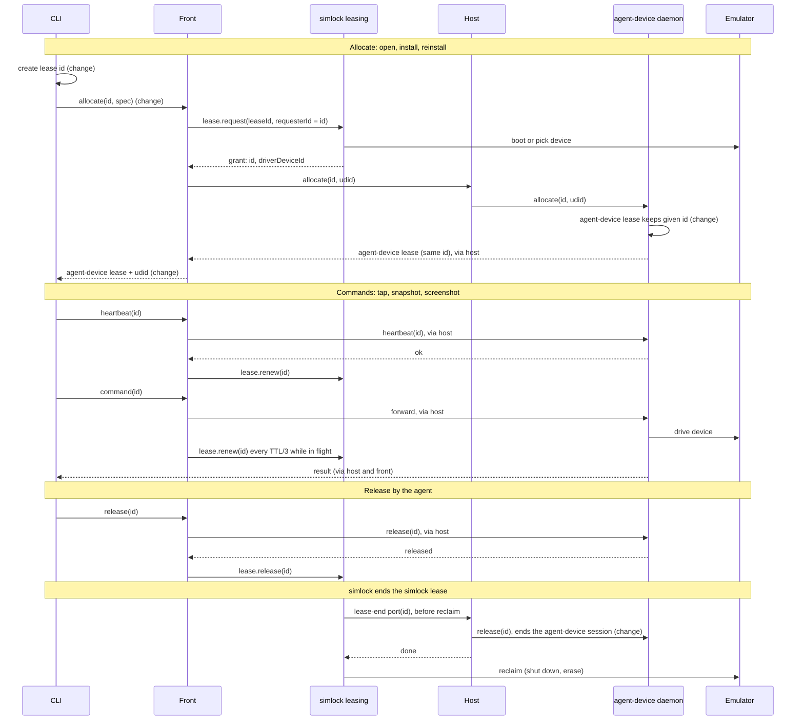

# agent-device through simlock

Working notes. Not committed. Worker mode is specified in #466; gateway mode gets its own feature later.

## Words

Both tools have a daemon, leases, sessions and tokens. For those four these
notes always say whose: "simlock lease", "agent-device lease", and so on.
Every other word below belongs to one tool only and goes without a prefix.

Clashing words:

- **simlock daemon.** The simlock process on a machine. Runs as a worker or a
  gateway.
- **agent-device daemon.** The agent-device process that drives devices. Here,
  one per worker, started by the supervisor.
- **simlock lease.** A device reserved for one principal, with a TTL. Renewed
  or released by its owner, ended by simlock on expiry.
- **agent-device lease.** "This device is mine for now": a reservation in the
  agent-device daemon with tenant, run ID, device and TTL. Every command is
  checked against it.
- **simlock session.** One authenticated caller, built from a simlock token.
  No device state.
- **agent-device session.** "What I'm doing on that device": made by `open`,
  ended by `close`. Holds the bound device, the open app, the last snapshot,
  the UI runner and the device claim. Points at the agent-device lease it was
  opened under.
- **simlock token.** The bearer token a client sends to simlock. It names a
  principal.
- **agent-device daemon token.** The secret the agent-device daemon makes at
  start; only the proxy holds it.
- **Proxy client token.** The one static token the proxy accepts from its
  clients.

One tool only:

- **CLI.** The `agent-device` command an agent runs, pointed at a simlock
  URL. simlock's own commands are named in full (`simlock doctor`).
- **Worker.** A simlock daemon that owns devices on its own machine.
- **Gateway.** A simlock daemon that owns no devices; it takes lease requests
  and passes them to workers.
- **Uplink.** The WebSocket a worker opens to its gateway.
- **Grant.** What simlock returns when a simlock lease starts: the lease, the
  device (`driverDeviceId`), the lease environment and, through a gateway, the
  worker.
- **Lease environment.** Environment variables in a grant that point a tool at
  the leased device (iOS device set, adb server port). simlock does not read
  them.
- **Principal.** Who a simlock token belongs to; the owner of the simlock
  leases made with it.
- **Tenant.** Who a request to the agent-device daemon belongs to;
  agent-device sessions and agent-device leases are kept apart by tenant.
- **Heartbeat.** The CLI's "still here" call, sent before every command.
  Renews the agent-device lease.
- **Device claim.** A file that keeps other agent-device sessions off a
  device.
- **Proxy.** `@agent-device/proxy`, a library that forwards agent-device HTTP
  traffic to an agent-device daemon.
- **Edge.** The new simlock module that serves agent-device traffic,
  `src/agent-device/`, made of the front, the host and shared code.
- **Front.** The part of the edge where the CLI connects: it checks the
  simlock token and turns agent-device lease calls into simlock lease
  operations.
- **Host.** The part of the edge on every worker: it runs the agent-device
  daemon and the proxy.
- **Host link.** How the front sends a request to a host: in-process in
  worker mode, over the uplink in gateway mode.
- **Supervisor.** The host code that starts and watches the agent-device
  daemon.
- **Auth hook.** A module the agent-device daemon loads
  (`AGENT_DEVICE_HTTP_AUTH_HOOK`) and calls on every request to learn the
  tenant.
- **Policy file.** The agent-device daemon's operator rules
  (`AGENT_DEVICE_DAEMON_POLICY`): commands, devices, capabilities.
- **Lease-end port.** New simlock leasing hook, called after a simlock lease
  ends and before its device is reclaimed.

## Goal

Point the CLI at a simlock URL (a worker first, a gateway later). It leases a
device from simlock by spec and runs its commands on it. The agent-device
lease and the simlock lease share one ID and one lifetime. When one agent's
simlock lease ends, the next agent can lease the same device as soon as
simlock has reclaimed it.

Commands always go CLI → front → host → agent-device daemon → device. The CLI
never talks to the device itself.

## How it fits together

The edge is one optional module, `src/agent-device/`, and the only simlock
code that knows about agent-device; the simlock core and simlock lease
records do not. It has three parts, split by role, not by mode:

```
src/agent-device/
  shared/   agent-device wire knowledge: route list, RPC parsing (lease calls,
            command names, selector flags), lease ID format, error shapes
  front/    where the CLI connects (/v1/agent-device/*): simlock token check,
            lease calls → simlock lease operations, the front map, request
            rules; sends each request to a host through the host link
  host/     on every worker: supervisor, proxy, policy file, auth hook,
            version check, the host record, lease-end participant
```

| simlock daemon | front | host |
|---|---|---|
| Worker, worker mode | yes | yes (in-process host link) |
| Gateway | yes | no |
| Worker behind a gateway | optional, for agents connecting directly | yes (host link over the uplink) |

- **Front map** (front): lease ID → principal → worker → who ended the
  simlock lease. Only the front sees the agent's simlock token.
- **Host record** (host): lease ID → tenant, run ID, agent-device session
  names, in-flight requests. Built from the requests the host hands to the
  proxy.
- **The agent-device daemon.** One per worker, started by the supervisor,
  installed by the operator (never downloaded), with every simlock driver's
  lease environment, passed through unread.
- **Plugged in, not imported.** The simlock core imports none of the three
  parts. The front mounts through a new HTTP mount option; the host plugs
  into the lease-end port; in gateway mode the host link uses a relay
  operation with a neutral name in simlock's contract.

Worker mode first, gateway mode after.

## Out of scope

- **Physical devices** (ADR 0022). They use a different adb server than
  emulators, and one agent-device daemon talks to one adb server.
- **Platforms other than iOS and Android.** The front refuses them.
- **Choosing a worker by feature.** Every worker must have agent-device
  installed when the gateway has the front on; agent-device is planned to
  become always required.

## Lease flow

1. The CLI makes a lease ID: 32 lowercase hex characters.
2. The CLI sends `allocate(id, spec)` to the front.
3. The front calls simlock `lease.request` as the agent, with `leaseId: id`,
   `requesterId: id`, and the spec mapped to `platform` and `model` or
   `class` (see Spec mapping). The simlock lease keeps the ID (ADR 0020).
4. simlock boots or picks a device. The grant names it (`driverDeviceId`)
   and, through a gateway, its worker.
5. The front sends `allocate(id, device)` through the host link to the host
   on that worker, which passes it to the agent-device daemon. The
   agent-device lease keeps the ID.
6. The front replies to the CLI with the agent-device lease and the device's
   udid or serial. The CLI uses that device from now on.
7. Before every command the CLI sends a heartbeat. The front forwards it to
   the agent-device daemon, renews the simlock lease once that succeeded, then
   forwards the command.
8. The agent releases: the front forwards the release to the agent-device
   daemon first, then releases the simlock lease once that succeeded.
9. simlock ends the simlock lease (expiry, release-all, device lost): before
   reclaiming the device, the worker's simlock leasing calls the host through
   the lease-end port. The host releases the agent-device lease, which ends
   the agent-device session (agent-device change 6), then simlock reclaims.



"(change)" marks steps that need an agent-device change.

## Rules the front follows

- **Which leases it touches.** Only simlock leases in the front map, built
  from the allocates it forwarded. It acts on them as their owner, with that
  agent's simlock session built in-process. It never lists simlock leases and
  never uses an admin simlock session. One exception: a heartbeat naming a
  lease ID the map lacks (after a simlock daemon restart); the front may
  release it as the token's principal, and simlock's own ownership check
  decides.
- **Renewal.** Same TTL on both leases: the CLI's 5 minutes. Renew the
  simlock lease on every heartbeat. While a command for the lease is running,
  renew it every TTL/3 and once when it ends; the agent-device daemon holds
  its own agent-device lease during a running command, and the simlock lease
  would otherwise expire mid-command.
- **Heartbeat.** agent-device first. OK: renew the simlock lease. "Lease not
  found", or the simlock lease is gone: the answer depends on who ended it.
  - The agent ended it (plain `close` or release, remembered in the front map
    for a while): answer `LEASE_NOT_FOUND`, so `close` then `open` works.
  - Anything else (simlock ended it, the agent-device daemon restarted, or
    the ID is unknown after a simlock daemon restart): answer
    `LEASE_ENDED_BY_HOST` (stopgap step 3). If simlock still holds the lease,
    release it by ID as the token's principal first.

  Unreachable or timeout: return the error and renew nothing.
- **agent-device allocate fails after a grant.** The front releases the
  simlock lease at once and passes the error to the CLI.
- **Release by the agent.** agent-device first: the front sends the release
  through the host (with the stopgap, the host closes the agent-device
  sessions first), then releases the simlock lease. If the agent-device
  release fails, the front keeps the simlock lease and returns the error, so
  simlock never frees a device agent-device still holds.
- **Plain `close`.** The agent-device daemon releases the agent-device lease
  itself on `close`, so no release passes the front. After forwarding a
  `close` that succeeded for a lease in its map, the front sends a heartbeat
  for that agent-device lease. If the agent-device daemon answers "lease not
  found", the front releases the simlock lease. If the agent-device lease is
  still there (`retainOnClose`), it does nothing. Drop this once recommended
  change 11 ships.
- **Device selectors.** The front refuses a request whose `--udid`,
  `--serial` or `--device` names any device but the one in that agent's grant
  (`test --device a,b` lists included), and any request with
  `--ios-simulator-device-set` or `--android-device-allowlist`: the first can
  point the agent-device daemon at simulators outside simlock's device root.
  Drop this once agent-device change 8 ships.
- **Waiting allocate.** The front holds the CLI's allocate request open while
  the simlock lease request waits in the queue. When the CLI hangs up (or its
  own allocate deadline aborts the request), the front cancels the waiting
  request (`lease.cancel` by requester, which is the lease ID). A grant that
  lands after the hang-up is released at once. simlock needs no `timeoutMs`:
  the CLI's own deadline bounds the wait.
- **Failed allocate.** The CLI makes a new lease ID for every allocate
  attempt and never retries with the old one (ADR 0020: an ID is never
  reused). The front sends no idempotency key.
- **simlock daemon restart.** The front map is lost. The simlock leases
  survive the restart; the first heartbeat for one releases it (see
  Heartbeat).
- **Tenant.** The front sets the tenant header to the principal on every
  request; the auth hook attests it (see Tenant).
- **Routes.** The front refuses anything outside a fixed list of agent-device
  routes, and refuses an `install` or `reinstall` whose request carries no
  `meta.uploadedArtifactId` (a local file always arrives as an upload;
  `install <app> remote:/path` sends a worker path). Every route needs the
  simlock token, `/health` included: the CLI sends it there too.
- **`devices`.** The front answers with only the devices this simlock
  token holds: empty before `open` (#466).
- **Upload tickets.** An upload is a preflight, then a `PUT` to the URL in the
  ticket the preflight returns. The proxy puts the proxy client token in the
  ticket headers, and the CLI sends the `PUT` with only those headers. So the
  front swaps it in the preflight reply for the agent's own simlock token,
  taken from the preflight request. Then the `PUT` passes the front's normal
  check, and no agent sees the proxy client token. The front never logs
  preflight replies or `PUT` headers, which now hold the agent's simlock
  token. Drop this once recommended change 10 ships.
- Revoking a simlock token ends no simlock lease.

## Rules the host follows

- **Trusts the host link only.** In worker mode the front calls it
  in-process; in gateway mode it accepts only relayed requests from the
  uplink, already authenticated by the worker's join token. It does no
  simlock token check of its own.
- **Host record.** It records each agent-device lease's tenant and run ID
  from the allocates it forwards, the agent-device session names from the
  `open`s, and every request it has handed to the proxy and not yet answered.
- **simlock lease ends.** The worker's simlock leasing calls the host through
  the lease-end port: after the simlock lease is committed as ended, before
  the device is reclaimed (shut down, erased). It waits until the commands
  still running on that lease finish, as agent-device itself does, up to a
  ceiling (default 10 min, like `exec.timeoutMs`); then reclaim goes ahead
  whatever the host did (#466). No events and no timer: simlock's
  architecture rule 5 forbids workflow steps in event handlers. The host
  sends `agent_device.lease.release` with the recorded tenant and run ID;
  agent-device ends the agent-device session after its running command
  (change 2, PR2). It is
  local to the device's machine and works the same in both modes.
- **agent-device daemon restart.** The supervisor restarts it; the new
  agent-device daemon has a new agent-device daemon token, so the host
  recreates the proxy with it and clears its host record. CLIs get a 409
  (proxy instance changed) and re-read `/health`. Each agent's next heartbeat
  finds no agent-device lease, so the front releases its simlock lease and
  answers `LEASE_ENDED_BY_HOST`.
- **Client's original URL.** The host passes the URL the CLI used (from the
  front) to `proxy.handle()`, so upload tickets point back at the front.

## Tenant

The CLI sends a simlock token and the front checks it. The agent-device
daemon never sees that token: every agent reaches it through the same proxy,
so it tells agents apart only by the tenant in the request. Today every proxy
client is tenant `proxy`, so two agents share agent-device session
`proxy:default`.

So the front sets the tenant header `x-agent-device-tenant` to the principal
on every request, overwriting whatever the client sent. The proxy forwards
that header on every route.

simlock ships a small auth hook with the host, and the supervisor names it in
`AGENT_DEVICE_HTTP_AUTH_HOOK`. The agent-device daemon calls it on every
request; it returns the tenant from that header and refuses a request without
one. The attested tenant also replaces the tenant inside agent-device lease
calls, so the agent-device lease and the agent-device session use the same
tenant (`http-server.ts:276`).

A tenant from the auth hook is attested, which buys two things:

- The agent-device daemon forces tenant isolation; a request cannot opt out.
- The agent-device daemon treats every caller as remote: it refuses path
  install sources, ignores a requested developer directory and credential
  probes, and lets Maestro HTTP helpers reach public addresses only. It does
  not close the `install <app> remote:/path` hole (change 4).

The supervisor gives the agent-device daemon a private state directory (mode
0700) under simlock's, so the agent-device daemon token is not in the usual
`~/.agent-device`.

One simlock token is one tenant and one principal: agents must not share a
simlock token. Recommended change 10 would replace the header and the auth
hook.

## Spec mapping

In proxy mode the CLI sends its own selectors with allocate; the front maps
them to simlock's `lease.request`:

| CLI | simlock | Notes |
|---|---|---|
| `--platform ios` / `android` | `platform` | Any other platform is refused. |
| `--target mobile` / `tv` / `desktop` | `class` phone / tv / desktop | simlock's tablet, watch and vision cannot be asked for. |
| `--device "iPhone 17 Pro"` | `model`, and no `class` | simlock refuses a request with both. agent-device matches names, simlock models; users type the model. |
| `--udid` / `--serial` | refused | No device exists yet; simlock picks it. |
| — | `osVersion`, `mode`, `imageTag` | Not selectable in the first version; simlock's defaults apply. |
| — | `physical: false`, `allowDownload: false` | Physical devices are out of scope; simlock never downloads implicitly. |

Changes: the CLI sends its selectors (change 1); the front maps them.

## agent-device changes

Required:

1. **Allocate by spec; the reply names the device.** In proxy mode the CLI
   stops picking a device before it allocates (today it throws when none or
   several match, which is normal before simlock boots one), sends its
   `--platform`, `--target` and `--device` selectors (today allocate carries
   `platform` and `device` only, not `target`), reads the udid or serial from
   the reply, and keeps it between commands. Additive: the agent-device
   daemon's allocate picks by spec when given no exact device (same rules the
   CLI uses today) and names the device in its reply; it still accepts an
   exact device; the CLI falls back to today's local pick when a reply names
   no device; no RPC protocol bump.
2. **The CLI makes the lease ID; the agent-device daemon keeps it.** Today
   the CLI strips it, the RPC drops it, and the agent-device daemon makes its
   own. A new ID for every allocate attempt, including a retry.
3. **An iOS device set for the whole agent-device daemon**, read from
   `AGENT_DEVICE_IOS_SIMULATOR_DEVICE_SET` when a request names none (today
   only a per-request flag or a config key exists). Without it the
   agent-device daemon cannot see simlock's simulators. On Android, adb
   already reads `ANDROID_ADB_SERVER_PORT` from the agent-device daemon's
   environment.
4. **Close the `install <path>` hole.** `install <app> remote:/path` (or a
   hand-written RPC) puts a worker path in the positionals, and the
   agent-device daemon reads it; the proxy and the remote mode only check
   `source.kind: "path"` (`daemon-artifacts.ts:117`).
5. **A lease ID on uploads, artifacts and diagnostics** (gateway only). These
   requests carry no lease ID, so until this ships the gateway routes them by
   simlock token (see Known gaps).
6. **An agent-device lease ending ends its agent-device session, at once.**
   Today release does not, and expiry does so only lazily, on the owner's
   next request; if the agent-device daemon's sweep drops the expired lease
   first, never. The agent-device session keeps the device claim, its owner
   can no longer `close` it, and the next agent's `open` on that device fails
   with `DEVICE_IN_USE`. A heartbeat can also leave the agent-device session
   pointing at an old agent-device lease, so the next command fails with
   `LEASE_SESSION_MISMATCH` (inferred from the code, not run). A bug without
   simlock too, and no test covers it. Fix: on expiry and release, tear down
   the agent-device session and clear its claim, even if the device is gone;
   add a timer for expiry.
7. **In proxy mode only open, install and reinstall allocate.** Today a lost
   agent-device lease makes any command allocate a new one; through simlock
   that is a `lease.request`, so a `tap` could lease or boot a clean device
   and tap on it. Other commands should fail with "lease lost, run open".
8. **A command acts only on its agent-device lease's device.** Today a
   `--udid`, `--serial`, `--device` or `--ios-simulator-device-set` flag picks
   any device the agent-device daemon can see, and nothing compares it with
   the agent-device lease (`session-device-resolution.ts:39`). Without an
   agent-device session the only check is that the agent-device lease exists;
   with one, `apps`, `capabilities`, `devices` and `doctor` still let an
   explicit device win. So an agent can screenshot, install on, boot or shut
   down another agent's device. A bug for any proxy deployment, like change 6.
   Fix: under tenant isolation, the resolved device must be the agent-device
   lease's device.

Recommended:

9. The proxy keeps the `range` and `x-upload-offset` headers on a partial
   upload (today every resume restarts from zero) and `content-length` on
   downloads.
10. An `authenticate(request)` option in the proxy that sets the tenant and
    puts the caller's own credential in upload tickets, so the front does
    neither.
11. In proxy mode the CLI sends a lease release after `close`, as
    `disconnect` already does. The release passes the front, which ends both
    leases, and the front no longer has to check after `close`.

Also: agent-device's ADR 0021 says agent-device does not call simlock; it
needs updating. Changes 1–3 and 6–8 name no simlock.

## simlock changes

Core, neutral names, no agent-device knowledge:

- **The lease-end port** in leasing: leasing calls each registered
  participant after a simlock lease is committed as ended and before the
  device is reclaimed, waiting up to a ceiling (default 10 min). The device stays `reclaiming`,
  so nobody else is granted it meanwhile.
- **An HTTP mount option** so an optional module can serve routes under
  `/v1/<prefix>`; there is no route hook today.
- **The relay operation** (gateway mode, see Gateway mode).

The edge, `src/agent-device/`:

- **shared:** route list, RPC parsing, lease ID format, error shapes.
- **front:** token check, lease translation and the front map, the rules
  above, the host link port with its in-process adapter.
- **host:** the supervisor (config keys, pid record, identity check before
  signalling, reap on stop, like `drivers/android/adb-server.ts`), which
  starts the agent-device daemon with every simlock driver's lease
  environment merged, `AGENT_DEVICE_IOS_SIMULATOR_DEVICE_SET` set from the
  iOS driver's `SIMLOCK_IOS_DEVICE_SET`, a private state directory, the auth
  hook, and a policy file that denies `boot`, `shutdown` and the
  `device-shutdown` capability (simlock owns device lifecycle); the proxy as
  a pinned dependency behind a port with a fake; the host record; the
  lease-end participant.
- **Version check at start.** The supervisor reads the installed
  agent-device daemon's version and compares it with the range the pinned
  proxy supports. Outside it, the simlock daemon does not mount the edge and
  says why in its log and in `simlock doctor`. The CLI needs nothing: it
  already reads `/health` and refuses a proxy or agent-device daemon with
  another RPC protocol version.

No driver changes: the iOS driver keeps exporting only `SIMLOCK_IOS_DEVICE_SET`.
A local agent-device started after `eval "$(simlock lease --export-env)"`
passes `--ios-simulator-device-set "$SIMLOCK_IOS_DEVICE_SET"`, as
agent-device's ADR 0021 already says.

Also:

- **A test TTL cap** config key (see End-to-end tests).
- **Docs:** HTTP-API.md, CONFIGURATION.md, COMPONENTS.md, CLI.md and
  CLIENT.md (which says agent-device has its own supervisor).
- **ADRs:** one for the edge (ADR 0003 says frontends only render the
  contract; the front keeps a map and renews simlock leases on its own), one
  for the lease-end port (a core change), and one for the tunnel (gateway
  mode).

## Stopgap until agent-device changes 6 and 7

**Dropped (#466):** every agent-device change is assumed released first;
simlock builds no stand-ins and tests against a local agent-device build.

Remove once those ship. The agent-device lease never ends on its own; the
edge ends it, closing the agent-device session first while `close` still
works.

1. The supervisor starts the agent-device daemon with a large
   `AGENT_DEVICE_LEASE_MAX_TTL_MS` (e.g. 24 h), and the front raises `ttlMs`
   to it on everything it forwards to the agent-device daemon. The simlock
   lease is the only clock.
2. When a simlock lease ends (through the lease-end port, or released by the
   agent), the host closes every agent-device session on it, as that tenant
   with the agent-device lease details in its host record, then releases the
   agent-device lease.
3. When simlock ended a lease, the front answers its heartbeat with a reason
   the CLI does not treat as "lease gone" (`LEASE_ENDED_BY_HOST`). The command
   fails instead of allocating a new lease; the agent runs `disconnect`, then
   `open`. A lease the agent ended gets `LEASE_NOT_FOUND` instead (see
   Heartbeat).
4. The simlock daemon reaps and restarts the agent-device daemon when it
   starts.

Cost: the edge knows more of agent-device's wire format. Needs a test: a host
`close` with the recorded agent-device lease details passes and frees the
device for another tenant.

## Gateway mode: the tunnel

Its own ADR. No HTTP tunnel is needed: the proxy takes an
`upstreamFetch(Request) → Response` for any transport, so simlock carries
Request and Response objects over the uplink.

- **Where to cut.** The front runs on the gateway, the only place that sees
  the agent's simlock token; the host runs on the worker, next to the
  agent-device daemon. The host link's uplink adapter sends the finished
  Request, with the client's original URL, over the uplink; the host hands it
  to `proxy.handle()` and sends the Response back. The agent-device daemon
  token never leaves the worker.
- **Bodies: base64 chunks in today's JSON protocol, for now.** A new contract
  operation with a neutral name (e.g. `relay.request`) carries method, URL
  and headers; body chunks of about 256 KiB go both ways as messages tagged
  with the call, then an end marker. Costs a third more bytes on the wire.
  Binary frames come later (see Planned).
- **Deadlines and cancellation.** When the CLI hangs up, the gateway sends a
  cancel to the worker, which aborts the Request it gave the proxy (the proxy
  then cancels the agent-device daemon's work). When the uplink drops, the
  gateway fails its in-flight calls with a clear error and the worker aborts
  every relayed request. Every relayed call has a gateway deadline of the
  proxy's upstream timeout plus a margin (e.g. 5 min + 30 s); past it the
  gateway cancels on the worker and answers with a timeout. The front also
  bounds its own simlock renew and release calls, which have no deadline in
  the gateway today.
- **Routing.** `/rpc` and allocate go to the worker recorded in the front map
  from the grant. Uploads, artifacts and diagnostics carry no lease ID, so
  the gateway sends them to the worker of the principal's one simlock lease,
  and refuses with a clear error when the principal holds none or several.
  This relies on the CLI uploading after it allocates (read from the code;
  the gateway e2e scenario proves it). Once change 5 ships, route those by
  lease ID and drop the one-lease rule.
- **Ownership.** A worker stores the agent's real principal as the simlock
  lease's owner; only the requester carries the gateway's prefix
  (`gw:<id>:<requester>`).
- **Lease end.** Handled by the host on the worker, through the worker's
  lease-end port; nothing crosses the uplink before reclaim.
- **Protocol and workers.** The gateway–worker protocol version goes up by
  one for the relay operation. On a worker without agent-device, the
  agent-device allocate fails and the front releases the simlock lease
  ("allocate fails after a grant").

## End-to-end tests

A scripted suite (no agent in the loop) that proves the whole thing works on
one machine, with real devices. Changes: simlock only.

- **Where.** simlock's `e2e/`, tagged `slow` (plus `ios` or `android`) like
  every other real-device test, run through `scripts/slow-e2e.sh`.
- **What runs.** Real processes: the simlock daemon, the agent-device daemon
  under the supervisor, and the real CLI as a child process, pinned as a dev
  dependency at the proxy's version. agent-device has no fake device backend,
  so real simulators and emulators are needed.
- **Isolation.** Each test gets its own simlock device root and adb server
  port, and each CLI its own `HOME`, so tests never touch the user's devices
  or agent-device state.
- **Topology.** Worker mode: one simlock daemon serving HTTP on loopback.
  Gateway mode, later: a gateway and one worker process on the same machine,
  as `e2e/single-host-fleet.test.ts` does.
- **Checks.** CLI exit codes and JSON output, plus simlock's own status and
  events.
- **Fixture apps:** Appduct's native playgrounds, prebuilt and committed.
  Source: `callstackincubator/appduct` (checked out as `../cordierite`),
  `playground-native/ios` (xcodegen + xcodebuild, simulator build) and
  `playground-native/android` (Gradle debug apk, about 10 MB). Built from a
  pinned commit and committed under `e2e/fixtures/appduct/` with a README
  naming that commit and the build commands. The builds already in
  `../cordierite` are older than its last `playground-native` change, so
  build fresh at the pin.
- **Both platforms**, iOS and Android.
- **Wall clock:** reuse one booted device across scenarios where possible.
- **TTL:** a simlock config key caps the front's simlock lease TTL so expiry
  takes seconds, not 5 minutes. Only the expiry and restart scenarios set it:
  renewals ride on heartbeats, so a seconds-long cap would expire leases
  between ordinary commands.

Scenarios:

1. Happy path: `open`, `snapshot`, `tap`, `screenshot` (artifact download),
   `install` (upload), `close`; the device is free in simlock afterwards.
2. Two agents, two simlock tokens: separate agent-device sessions; agent B's
   `--udid` naming agent A's device is refused.
3. Shared lifetime: simlock `release-all` ends the agent-device lease and
   agent-device session before the device is reclaimed; once simlock has
   reclaimed it, the next agent's `open` on that device succeeds.
4. Expiry: kill a CLI mid-session; the simlock lease expires within the TTL
   and the device can be leased again.
5. Queue: with every device taken, a second agent waits; kill its CLI and the
   waiting simlock lease request is gone, never granted later.
6. A plain `close` frees the simlock lease straight away, and a following
   `open` works.
7. The agent-device daemon is killed: the supervisor restarts it, the next
   heartbeat answers `LEASE_ENDED_BY_HOST`, and the simlock lease is released.
8. The simlock daemon restarts: the agent-device daemon is restarted, and the
   old simlock leases are released on the next heartbeat or expire within the
   TTL.
9. Refusals: `install <app> remote:/path`, `boot`, `shutdown`,
   `--ios-simulator-device-set`.
10. Wrong agent-device version: the edge is not mounted and `simlock doctor`
    says why.
11. Gateway mode: the happy path through the gateway, with an upload larger
    than one uplink chunk.

Scenarios that depend on an agent-device change test the behaviour, not the
mechanism, so they stay green when the stopgap is replaced by the change.

## Known gaps

Accepted for the first version.

- **Worker files through other flags.** Flags other than `install`'s path
  (e.g. `--out`, `--artifacts-dir`, `--steps-file`, Metro and XCTest paths)
  may make the agent-device daemon read or write files on the worker.
  agent-device checks this list only for macOS app leases.
- **Trust boundary is the worker's OS user.** The agent-device daemon listens
  on loopback; any process running as the simlock user can read the
  agent-device daemon token from its state directory and skip the edge.
- **New selector flags.** The front's device-selector check knows today's
  flags; one added in agent-device slips past until change 8 ships.
- **`open` can still boot a device.** The policy file denies the `boot`
  command, not booting inside `open`, so agent-device can boot a device
  simlock thinks is shut down.
- **One simlock lease per simlock token in gateway mode**, until change 5
  ships (see Routing).
- **Shared uplink.** Big transfers can delay simlock lease renewals on the
  same uplink (fix in Planned).
- **Lost grant reply.** If a grant was sent but the reply was lost, that
  simlock lease is never renewed and stays held up to 5 minutes.
- **Leases nobody heartbeats.** After a simlock daemon restart or an
  agent-device daemon restart, a simlock lease whose agent never heartbeats
  again stays held up to 5 minutes.
- **Reclaim takes time.** The next agent waits for simlock to shut down and
  erase the device (tens of seconds on iOS).

## Planned after the first version

The first version proves the integration works; these tune it.

- **Binary chunks on the uplink.** Replace base64 chunks with binary
  WebSocket frames (call ID and sequence in a small header). Needs the
  `IpcConnection` port, the WebSocket adapter and the in-memory adapter to
  carry binary; the relay operation stays the same. Changes: simlock core.
- **Flow control on the uplink.** simlock's own messages skip ahead of relay
  chunks, a chunk goes to the socket only while its send buffer is small, and
  the receiver grants credit per call (e.g. 4 chunks) as it passes chunks on,
  so a slow reader cannot make chunks pile up in memory. Changes: simlock
  only, one more protocol message. Add an e2e check that simlock lease
  renewals arrive on time during a big upload.
- **Longer proxy timeout for slow uplinks.** The proxy's 5-minute upstream
  timeout covers streaming the body too, so a large upload over a slow uplink
  fails. Make `upstreamTimeoutMs` a config key. Changes: simlock only.
- **An opaque lease spec.** agent-device gets a field it never reads (e.g.
  `leaseSpec` in its remote config, or `--lease-spec key=value`) and forwards
  it with allocate; the front takes `osVersion`, `mode`, `imageTag` and
  `class` from it. Opens all of simlock's spec (including tablets, watches
  and OS versions) without an agent-device flag per field. Changes: both;
  agent-device adds the field, the front reads it.
- **A separate OS user for the agent-device daemon**, so other processes on
  the worker cannot read its token.

## Still open

1. **agent-device side:** update its ADR 0021, agree the changes with its
   maintainers, file changes 6 and 8 as bugs.
